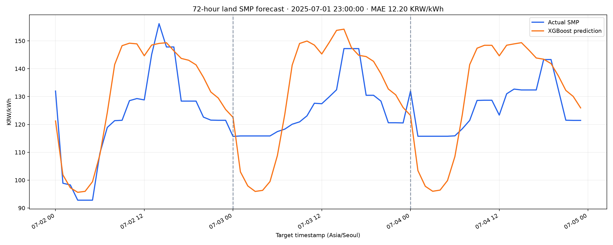

# SMP XGBoost: land SMP 72-hour forecast

This folder contains the XGBoost 72-hour run using common dataset version smp72h_common_v5_generation_v2_xgb_20261119.

## Input update

Only input group 5 changed from the prior run. It now uses the team's kpx_generation/20261119_v2 data: https://github.com/gemmanzu-a11y/smp-graduation-2026/tree/main/shared_datasets/kpx_generation/20261119_v2. The exact integrated file, README, manifest, and missing-interval list are included in data/generation_20261119_v2/.

The v2 panel contains 26,304 hourly rows for 2023–2025. Source kinds are annual 2023, API 2024, and annual 2025. In 2024, 24 LNG and bituminous-coal observations and 768 anthracite, nuclear, and combined-coal observations are missing; these remain flagged and are imputed using Train-only medians. The source represents market-traded sent-out energy and does not separate mainland and Jeju.

All other input groups, feature rules, issue times, targets, and Train/Validation/Final Test schedules match the prior common dataset. The complete common dataset version is included under data/shared_dataset_v5/. To keep each GitHub file below its size limit, forecast_inputs.csv, hourly.csv, and evaluation_targets.csv are gzip-compressed. The restore script expands them into SMP_SHARED_DATA/versions/ and refuses to overwrite an existing dataset version.

## Results

| Split | MAE (원/kWh) | RMSE (원/kWh) | R² |
|---|---:|---:|---:|
| Validation | 10.48 | 14.28 | 0.527 |
| Final Test | 20.07 | 23.96 | -0.079 |

Final Test MAE is worse than the recent-daily baseline (13.09 원/kWh) and weekly baseline (11.43 원/kWh). See reports/72h/smp72h_common_v5_generation_v2_xgb_20261119/final_evaluation_report.md for full metrics, limitations, and data checks.

## Main files

- Predictions: outputs/predictions/72h/smp72h_common_v5_generation_v2_xgb_20261119/predictions_72h.csv
- Metrics: outputs/metrics/72h/smp72h_common_v5_generation_v2_xgb_20261119/
- Model: artifacts/72h/smp72h_common_v5_generation_v2_xgb_20261119/xgboost_model.json
- Reports: reports/72h/smp72h_common_v5_generation_v2_xgb_20261119/
- Representative issue plot, 2025-07-01 23:00: outputs/figures/72h/custom/smp72h_common_v5_generation_v2_xgb_20261119/sample_72h_20250701_23.png

## Reproduce

From the repository root, install the project requirements, restore the bundled common dataset, then run:

python -m pip install -r SMP_XGBOOST_2026/requirements.txt
python SMP_XGBOOST_2026/scripts/restore_shared_dataset.py
python SMP_XGBOOST_2026/src/models/train_xgboost_72h.py --dataset-version smp72h_common_v5_generation_v2_xgb_20261119
