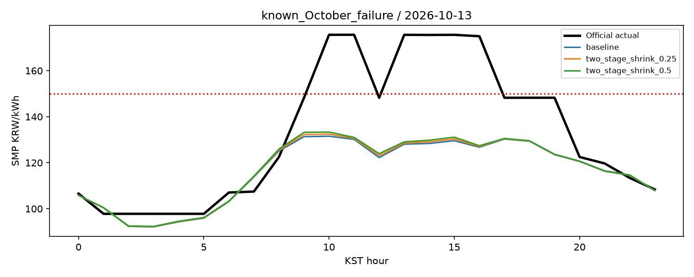
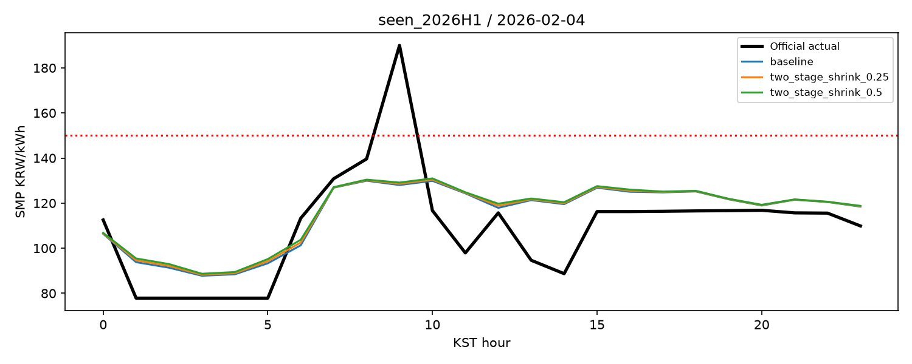
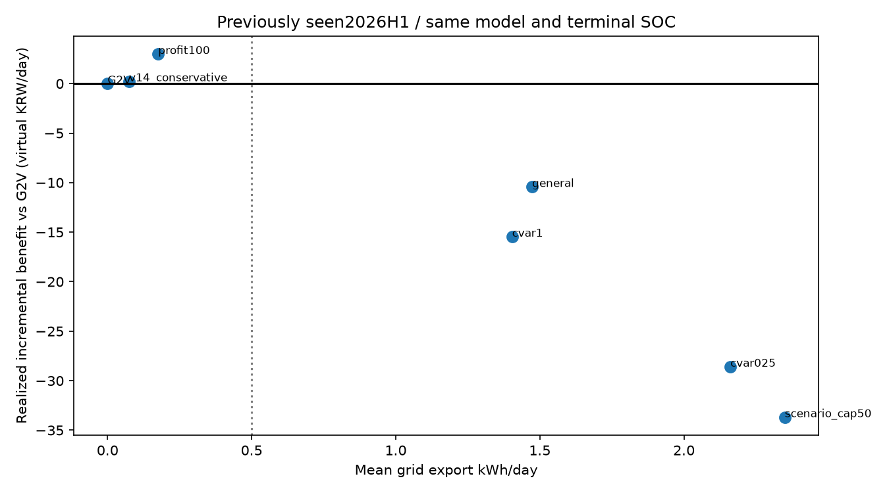

# V15 연구 결과 — 2026-10-16

기존 운영 모델은 유지한다. 두 단계 급등 모델을 축소 혼합하면 과거 시간순 검증의 급등 MAE와 EV regret가 개선되지만 전체 MAE는 증가했다. 이미 열람한 2026년 10월의 고가 6시간을 여전히 탐지하지 못했다. 실질적인 방전량과 순이익을 함께 충족하는 V2G 정책은 검증되지 않아 기본 선택은 G2V다.

## 보존 및 연구 범위

기준은 V14 `0d41922`, 개발 브랜치는 `research/v15-event-risk-v2g-20261016`이다. V5~V14 코드와 기존 모델, main, 불변 예측, 기존 공유/비공개/팀원 ZIP 및 공개 배포는 보존한다. V14의 기존 25개 실험은 재학습하지 않았다. 모델·원자료·개인 EV 입력·상세 계획은 GitHub에 올리지 않고 `artifacts/v15/`에 보관한다. 공개 파일은 코드, 집계표와 연구 그림이다.

## 급등 사건과 실패 원인

SMP는 2023~2026년 최신 수신분을 사용했다. 2026년은 연간 완결 자료가 아니고 10월 17일까지 발표된 가격을 포함한다. 고가(150원/kWh 이상)와 D-2 동일 시간 알려진 가격 대비 20원 이상 상승을 별도 정의했다. 사건 길이는 1~2시간/3~5시간/6~71시간/72시간 이상으로 고정했다. 가격 수준, 지속시간, 양의 ramp, 알려진 가격 대비 상승을 `events/event_catalog.csv`에 보관했다. 두 기준의 사건은 겹치므로 합계 2,225개를 독립 사건 수로 해석하지 않는다.

- 150원 이상 비율: 2023년 58.30%, 2024년 15.64%, 2025년 2.00%, 2026년 수신분 13.02%. 동일 임계값이 연도별로 매우 다른 사건을 나타낸다.
- 2023년 고가에는 72시간 이상 7개 체제 사건과 6~71시간 225개 plateau가 있었다. 2025년에는 고가 175시간 중 137시간이 1~2시간 사건이고 6시간 이상 사건은 없었다. 가격 수준의 연도별 이동과 사건 형태 불균형을 구분해야 한다.
- 2026-10-13의 고가 6시간은 10, 11, 13, 14, 15, 16시다. 실제 174.98~175.61, D-2 알려진 동일 시간 프로파일 약106.9, 기준 모델 예측126.72~131.52, 혼합0.5 예측127.39~133.31이었다. 이 시점을 모델 선정에 사용하지 않았다.
- 21/33/42개 가격 피처로 찾은 학습 이웃에서도 13~14시 유사 입력의 고가 비율은 0이었다. 알려진 가격 패턴만 비슷하고 이후 급등은 달랐다. 이는 입력의 식별력 부족을 뒷받침하지만 원인을 확정하는 인과 증거는 아니다.
- 해당 날짜의 발전기 고장·가용성·입찰·수급 변화에 대한 당시 발표본을 확보하지 못했으므로 기상 또는 예비력이 원인이라고 단정하지 않는다. 평범한 시간이 많은 MAE 목표는 희귀 상승을 평균화하며, 단순 가중은 허위 경보와 다른 계절 오차를 늘릴 수 있다.

연도별 분모와 결측, 사건 유형별 OOF 성능은 `V15_YEAR_INCIDENCE.CSV`, `V15_TYPE_INVENTORY.CSV`, `V15_TYPE_PREDICTION_SCORES.CSV`, `V15_KNOWN_SIX_ANALOGS.CSV`에 있다. 예측이 없는 2023년 사건에 임의 예측을 채우지 않았다.

## 새 모델 실험 및 입력

새 접근은 4개 계열×3개 시간 fold=12개 학습 설정이며, 학습 없이 기준 모델과 두 단계 모델을 0.25/0.5로 섞는 후속 2개 설정×3 fold=6개 평가를 수행했다. 총 6개 접근, 18개 후보-fold 평가이며 기준 모델 평가 3개는 별도다. 후속 가설도 평가 전에 파일에 고정했다. 미검증 딥러닝이나 이름만 바꾼 반복 학습은 추가하지 않았다.

1. 사전 ramp·변동성 피처를 추가한 LightGBM 잔차 모델.
2. 최근 가격 표준편차로 정규화하고 상대 급등/하락 ramp에 가중치를 준 LightGBM.
3. 상대 급등 분류기 + 이전 구간 Platt 확률 보정 + 조건부 강도 회귀.
4. 알려진 가격 입력의 최근접 사례 모델.
5~6. 두 단계 출력을 기준 모델에 25%/50%만 혼합하여 오경보와 전체 오차 증가를 제한.

학습/보정/검증: ~2024-06 / 2024Q3 / 2024Q4; ~2024-12 / 2025Q1 / 2025Q2; ~2025-06 / 2025Q3 / 2025Q4. 2026년은 선정에 사용하지 않았다. 이 역사 구간들은 이전 연구에서 열람한 적이 있어 새로운 독립 테스트라고 주장하지 않는다. 시드42, CPU4, 하이퍼파라미터와 실패 이유는 `model_study/design_before_scores.json`, 각 fold JSON 및 코드에 고정돼 있다.

합격 기준은 fold 평균 전체 MAE 비율≤1.03, 급등 MAE≤0.98, G2V regret≤1.02, V2G regret≤1.00, 고가 F1 평균 비악화, 어느 fold도 MAE 비율1.2 초과 금지다. 급등 MAE는150기준이며 추가 상대20기준 F1도 저장한다.

| name | MAE_ratio | peak_MAE_ratio | G2V_regret_ratio | V2G_regret_ratio | qualified |
| --- | --- | --- | --- | --- | --- |
| event_features_lgb | 0.9500 | 1.0985 | 0.9730 | 1.0300 | False |
| relative_event_weight | 1.0603 | 1.0406 | 0.9752 | 0.9762 | False |
| relative_two_stage | 1.0552 | 0.9208 | 0.9504 | 0.9610 | False |
| event_analog | 1.0424 | 1.2223 | 1.3753 | 1.3522 | False |
| two_stage_shrink_0.25 | 1.0106 | 0.9799 | 0.9838 | 0.9911 | True |
| two_stage_shrink_0.5 | 1.0236 | 0.9599 | 0.9634 | 0.9734 | True |

비율은 각 fold 기준 모델 대비 비율의 산술평균이다. 단일 연결 평가의 개선율과 다르다. 최초 4개는 모두 탈락했고 혼합 2개만 후보 폴더에 저장했다. 상위 세 접근을 꼽으면 혼합0.25, 혼합0.5, 미혼합 두 단계 모델이나, 세 번째는 전체 MAE 기준 탈락이므로 운영 후보가 아니다.

42개 가격 입력 목록은 `V15_INPUT_FEATURES.json`에 있다. 가격의 시간·요일·계절·주말, 알려진 프로파일, 과거 rolling 수준/변동성/ramp/rank에 추가9개 `ramp_mean24, ramp_abs_max24, up15_fraction168, down15_fraction168, range_ratio24_168, origin_jump3, origin_jump6, profile_amplitude_ratio, known_tail_gap`을 사용했다. 계산 시각은 D-2 23시 이전이다. 이번 모델은 기상 관측·미래 수요 실적·발표본 미확인 수요예측을 사용하지 않는다. V11/V14의 기존 수집 결과는 보존한다.

### 이미 열람한 2026년 진단 (원/kWh, EV는 가상 원/일)

| model | cohort | MAE | peak_MAE | peak_F1 | G2V_regret | V2G_regret |
| --- | --- | --- | --- | --- | --- | --- |
| baseline | seen_2026H1 | 10.7951 | 34.0600 | 0.0769 | 190.5327 | 255.2205 |
| two_stage_shrink_0.25 | seen_2026H1 | 10.8618 | 33.3560 | 0.0769 | 190.6201 | 254.9843 |
| two_stage_shrink_0.5 | seen_2026H1 | 10.9454 | 32.6520 | 0.0769 | 190.8216 | 254.1622 |
| baseline | known_October_failure | 10.2927 | 46.4170 | 0.0000 | 해당 없음 | 해당 없음 |
| two_stage_shrink_0.25 | known_October_failure | 10.3642 | 45.8130 | 0.0000 | 해당 없음 | 해당 없음 |
| two_stage_shrink_0.5 | known_October_failure | 10.4551 | 45.2090 | 0.0000 | 해당 없음 | 해당 없음 |

상반기 혼합0.5는 급등 MAE 약4.1% 감소, 전체 MAE 약1.4% 증가, 고가 F1 동일, G2V regret 소폭 악화, V2G regret 약0.4% 감소다. 10월 고가6시간 F1은 모두0이다. 기존 D-1 23시의6.47 등과 이 D-2 모델의 오차는 입력 시점과 모델이 달라 직접 개선율로 비교하면 안 된다. 2025Q3 추가 계절 스트레스에서도 급등 MAE는 줄었지만 F1이0.1053에서0.0976으로 떨어졌다. 따라서 운영 승격 근거가 부족하다.

CSV 피처 재로드는 `float_precision='round_trip'`으로 고정했다. 기본 CSV 파서의 미세 부동소수점 차이가 트리 분기를 바꿀 수 있어, 최종 진단을 정정하고 기존 기준 모델 MAE10.7950663907 재현을 회귀 테스트했다. 최초 학습 결과와 저장 후보는 덮어쓰지 않았다. 최적화 정책 실험은 당시 동결 입력으로 수행한 결과를 유지했으며 최종 모델 진단만 정밀도 보정해 재계산했다.




## V2G 실효성 실험

두 기존 가격 모델×7정책×(2025Q4 92일 + 2026H1 181일)=3,822 정책·일을 실제 최적화했다. 배터리60kWh, 초기30%, 출발80%, 충방전7kW, 효율각90%, SOC20~90%, 연결24시간, 열화5원/배터리통과kWh, 가상 SMP 연동 정산이다. 모든 정책의 종단 SOC는80%로 동일하다. 국내 소매요금 또는 실제 V2G 판매수익이 아니다. 즉시/균등/G2V/V2G 사용자 조건 비교는 EV 탭에 유지한다.

G2V/일반V2G/V14 방전가격0.85 보수정책/점예측 이익100원 이상 정책/CVaR가중0.25/CVaR가중1/유한 시나리오 대비 G2V초과손실50원 상한을 비교했다. 시나리오는2025Q3 잔차의6개 일중 클러스터와2개 극단일 및0잔차로 만들었다. 동일 가중 스트레스이며 보정된 발생확률이 아니다.

선정은2025Q4에서 가상 추가이익≥10원/일, 평균방전≥0.5kWh/일, 활동≥10일, 손실빈도 일반V2G이하를 모두 만족하도록 사전에 고정했다. 두 가격 모델에서 적격 정책이 없어 G2V를 선택한 뒤2026년 진단을 열었다.

아래는 기존 shape 모델의 2026H1 181일 동일 조건 결과다. 추가이익은 동일 모델 G2V 실제 가상 비용과의 차이이고 음수는 손해다. 손실일은 계획 전체의 음수 수익이 아닌 G2V 대비 추가손실 발생일이다. 열화는 충전 통과량도 포함하므로 G2V에도 발생한다.

| policy | mean_export_kwh | active_days | mean_actual_additional_profit | loss_days | mean_degradation_cost | mean_actual_cost |
| --- | --- | --- | --- | --- | --- | --- |
| cvar025 | 2.3327 | 89 | -30.2720 | 83 | 175.9189 | 3418.0790 |
| cvar1 | 1.6020 | 64 | -11.6403 | 45 | 167.7997 | 3399.4472 |
| G2V | 0.0000 | 0 | 0.0000 | 0 | 150.0000 | 3387.8070 |
| general | 1.3346 | 61 | -5.3602 | 34 | 164.8293 | 3393.1672 |
| profit100 | 0.0983 | 2 | 1.4882 | 0 | 151.0927 | 3386.3188 |
| scenario_cap50 | 2.3866 | 107 | -37.7562 | 110 | 176.5175 | 3425.5632 |
| v14_conservative | 0.0746 | 7 | 0.6104 | 3 | 150.8287 | 3387.1966 |

일반V2G의 점예측 추가이익은+10.06원/일이지만 실제−5.36이었다. CVaR0.25는 시나리오 평균으로+34.14원을 기대했으나 실제−30.27원이었고 하루2.33kWh를 방전했다. 이는 방전을 하지 않아서 생긴 성과가 아니라 잘못된 잔차 분포 가정으로 활발하게 거래해 손실이 커진 사례다. 점예측 기준 해당 정책 예상이익은−4.96으로, 시나리오 기대와 구분해야 한다.

181일의 실제 가격이9개 시나리오 시간별 범위 안에 든 비율은 약74.3%, 하루24시간 모두 포함된 날은0이었다. 시나리오50원 상한 정책도 실제 G2V 대비50원 초과손실이62일 발생했다. 유한 시나리오 제한은 실제 미래 손실 보증이 아니다. 보수정책 평균방전0.075와 이익0.61, profit100 정책0.098과 이익1.49는 낮은 활동(각7일/2일)을 반드시 함께 표시한다. 특정 약한 진단 이익으로 실효성 개선을 주장하지 않는다.



## 전향 검증과 자동 수집

2026-10-16 현재, 기존 D-2 전향 대상은1일(10월17일), 발표가격 대조 완료1일, 급등 발생일0일이다. 대상일은 아직 경과 전이므로 완료란 공식 발표가격24개와 대조했다는 뜻이며 최종 수정통계 확정을 뜻하지 않는다. V15 후보의 새 전향 기록은0개다. 10월17일 가격은 이미 공개·수신돼 V15 신규 AI 미래예측 생성을 생략했다. 기존 기록을 수정하거나 과거 시각으로 발급하지 않았다. 최초 공개의 정확한 시각은 수신 표본만으로 확정하지 않는다.

V15는 기존 V11~V14 수집을 재사용하며 중복 API 수집하지 않는다. 예측 시 가격 원자료 first_seen≤D-2 23시, 모델 해시와 전체 입력, 실제 실행 지연, 불확실성 구간과7개 고정 EV 계획을 보관한다. 로컬 공식가격 확인 및 일반공개/EPSIS의20분 이내 정상 미관측 응답이 둘 다 있어야 후보 발급이 가능하다. 실패·오래된 응답을 미공개로 간주하지 않는다. 잔차90% 구간은 미래 보장 구간이나 보정된 급등확률이 아니다.

공식가격 도착 후 별도 버전 평가에 원예측/실제 해시, MAE/RMSE/급등/ramp/피크시각, 동결된 G2V/V2G regret를 저장한다. 모델 수를 독립 일수로 세지 않는다. 기존 수신 로그의 약354~370분 관측 공백은 누락으로 유지하며 노트북 절전·종료 여부는 시스템 근거 없이 단정하지 않는다.

Windows `GradprojectV15Candidates`:15분 간격, IgnoreNew,5분 제한, `-m v15.monitor`. 기존 V11~V14 작업은 유지한다. 등록 후 실제1회 실행의 종료코드0을 확인했다. 새 모델 자동 재학습/승격은 하지 않는다.

## 추가 공식 입력의 우선순위

1. 수요예측의 발표시각/변경이력을 갖춘 원본, 기상예보 발표본. D-2 23시 이전 수신을 증명할 수 있어야 한다. 사후 관측은 운영 대용으로 쓰지 않는다. 단기 격자 API403을 해결했다고 주장하지 않는다.
2. 발전기 가용·정비·고장 및 발전원별 공급전망. 가격 형성에 관련성이 있으나 공개 범위와 시각, 당시 원본 확보가 먼저다. [KPX 가격 형성 설명](https://www.kpx.or.kr/menu.es?mid=a10401040000).
3. 예비력과 제약 통계. 사후 월간 통계를 목표일 입력에 끼워넣지 않는다. [KPX 공개 일정](https://www.kpx.or.kr/menu.es?mid=a10109010000).
4. 연료가격은 공표일 기준 저빈도 체제 변수로 검토한다. 같은 시점에 고정된 연료값이 시간별 급등을 설명한다는 근거는 아직 없다.
5. [동서발전 익일 태양광 전망 공식 API](https://www.data.go.kr/data/15144541/openapi.do)는 별도 승인과 발표본 보존이 필요하며, 익일 전망이 D-2 기준에 제공된다고 가정하지 않는다.

새 공식 외생변수 원본은 이번 V15 모델에 추가 확보하지 못했다. 단순히 피처 수가42개로 늘었다고 정보가 충분해진 것이 아니다. 전향 급등 사례와 당시 수급 입력을 추가 축적해야 한다.

## 실행·시연·검증

PowerShell, 프로젝트 루트에서 기존 환경을 사용한다.

```powershell
..\.venv\Scripts\python.exe -m streamlit run app_v15.py --server.port 8505 --server.address 127.0.0.1
..\.venv\Scripts\python.exe -m v15.research
..\.venv\Scripts\python.exe -m v15.refinement
..\.venv\Scripts\python.exe -m v15.economics
..\.venv\Scripts\python.exe -m v15.events
..\.venv\Scripts\python.exe -m v15.reporting
..\.venv\Scripts\python.exe -m v15.monitor
..\.venv\Scripts\python.exe -m unittest discover -s tests -v
..\.venv\Scripts\python.exe -m scripts.smoke_v15
```

설치는 기존 requirements-v14.txt (기존 연구 의존성 포함)를 사용한다. 원자료·학습 모델을 GitHub만으로 받을 수 없으므로 로컬 연구 자산 또는 기존 별도 팀원 패키지가 필요하다. 기존 ZIP은 V15로 갱신하지 않았다. API 키는 수집할 때만 별도 환경변수에 등록하고 화면·코드·Git에 넣지 않는다. 재실행은 체크포인트를 재사용하며, 새로운 독립 연구를 하려면 기존 산출물을 덮지 않는 새 연구 폴더와 설계를 사용해야 한다.

화면은 http://127.0.0.1:8505/ 이며 과거 날짜·모델·정책을 선택하고 ‘저장된7개 정책 계획 비교’를 누르면 계산 당시의 계획·SOC·손익을 재생한다. 입력을 바꿔 최적화하는 EV 탭과 조건이 고정된 연구 정책 탭을 구분한다. 공식가격 모드/AI 후보/이미 열람한 진단/전향 대기를 표시한다. 공개 웹은 변경하지 않았다.

최종 테스트 수와 보존 해시 검증 결과는 `V15_VALIDATION.json`을 참조한다. 주요 회귀 검증은 미래 가격 변조 비영향, 과거 발급 차단, 공개 상태 신선도, 불변 기록, 시계열 fold, 음수가격/부분 시간/전력/SOC/효율/동시 충방전 금지/종단 SOC, 시나리오 제약, 실제 차익거래 가능성, 기존 및 신규 Streamlit 버튼, HTTP 서버 실행이다.


실행 검증: 전체76개 테스트(생략0) 통과, V15 HTTP health와 실제8505 서버 응답 정상, 새 Windows 작업 실제 종료코드0. 처음 샌드박스 권한에서 하드링크/localhost 검증이 제한되어 로컬 권한으로 재실행했다. 사건 분리 과정의 타임스탬프 해상도 오류도 수정하고 연속6시간 사건 회귀 테스트를 통과했다. 기존 기록89개·모델119개·ZIP3개의 SHA-256이 모두 동일하며 V5~V14 소스 차이는 없다. 개인 GitHub /user 신원을 parksiwon22로 확인했다. 설계 커밋9307fde, 구현 커밋b923503이며 최종 문서 커밋은 브랜치 최신 이력에서 확인할 수 있다.
