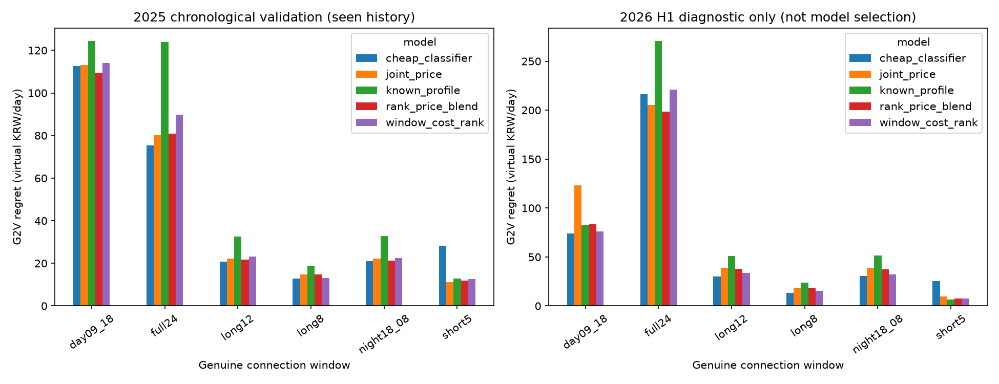
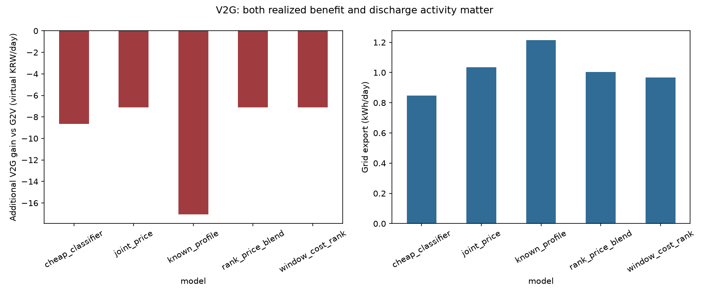
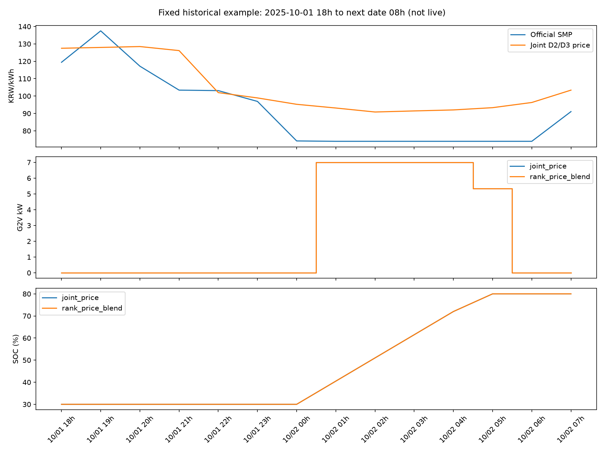

# V17 — 충전 시간대 학습과 실제 전향 기록 안정화

2026-10-17 KST. 기준 V16 `6a5e42a`, 개발 브랜치 `research/v17-charge-ranking-forward-20261016`.

**시간대 선택이 가격 MAE와 별개로 충전비용을 바꾸는 것은 확인했지만, 새 모델의 일관된 개선은 검증하지 못했다. 운영 모델과 기본 G2V 권장을 유지한다.** 새 학습은 2개 시간순 구간의 회귀·분류·순위 각 1개, 총 6회다. 혼합은 고정 비율이며 추가 학습하지 않았다. 2026년10월 급등 정답으로 후보를 선택하거나 알고리즘을 대량 반복하지 않았다.

## 실제 자동화 점검과 복구

- Windows 예약작업 6개를 검사했다. 동일 명령의 중복 작업은 없었다. V11 수집, V12 공개상태/예측, V13 감사, V14 후보, V15 후보, V16 감사는 역할이 다르다. `IgnoreNew` 중복 실행 제한과 실행 제한시간을 확인했다. 점검 시 최근 종료코드는 모두 0이었다(`V17_SCHEDULER_STATUS.json`). 이것이 매 실행 성공이나 수집 연속성을 보장하지는 않는다.
- V15의 실제 23시 실행에서 I/O 이후 5초를 넘긴 내부 시각이 과거 발급 방지 검사에 걸리는 오류를 확인했다. 기존 `v15/forward.py`를 수정하지 않고 V17 격리 어댑터로 동일 기준 원점 내 실제 현재시각을 다시 검사한다. 원점 변경·시간 역행은 거부한다. 공개가격·자료 수신 상태도 다시 확인한다.
- 실제 10월18일 대상 V15 후보 2개가 **10월16일23:06:22 KST**에 저장됐다. 6.37분 지연이며 정시23시 발급이라고 표시하지 않는다. 기존 모델과 예측 바이트는 유지했다.
- V15 예약작업 XML을 `artifacts/v17/scheduler/GradprojectV15Candidates_before.xml`에 먼저 보존하고, **같은 작업 이름**의 실행 명령을 `-m v17.service`로 이전했다. 일일23시와15분 재시도, 파일 잠금, 종료코드·실패단계·관측 공백 기록을 갖춘다. 다른 5개 작업은 유지했다. 일곱 번째 중복 작업을 만들지 않았다.
- V17 서비스 로그에 **약480.05분 관측 공백**이 있다. 종료/절전/실패 중 어느 원인인지는 확정하지 않았다. 노트북이 꺼지거나 절전이면 실행을 보장할 수 없다. 누락을 정상 실행이나 과거 예측으로 채우지 않았다.
- D3 공개 페이지 요청의 날짜 파라미터를 기존 검증 경로인 `issue_date`로 수정했다. 실패 응답은 미공개 증거가 아니다. D3 상태가 불확실하면 D2 24시간만 발급하고, 날짜를 넘는 계획은 `awaiting_eligible_D3`로 보류한다. 다음 날짜 가격을 복제하지 않는다. 이미 저장한 48시간 기록은 변경하지 않는다.

## 공식 API 가격 수신에서 발견한 사항

KPX `SmpWithForecastDemand/getSmpWithForecastDemand`에 대상일18일·19일을 각각 한 번 요청했고, 각24행을 받았다. 키는 전용 `KPX_SERVICE_KEY`로 읽고 URL 인증값을 출력하지 않았다. 기존 원문을 재사용하며 반복 네트워크 요청을 하지 않는다. 서비스는 각 새 원점 대상에 대해 최대2개 응답을 체크포인트로 수집한다.

응답을 검사하니 수요 필드 외에 **육지 SMP 24시간 값도 포함**돼 있었다. 날짜·육지 구분·1~24시·유한 수치·원문 해시를 검증한 뒤 가격 저장소에 원수신 시각으로 추가했다. 과거 발표시각을 발명한 것이 아니며, 원수신 시각은 검증된 기존 수신 메타데이터를 사용한다. 같은 스냅샷은 다시 적용하지 않고, 더 늦게 수신한 정정 가격을 오래된 캐시로 되돌리지 않는다.

|대상일|응답 행|실제 최초 수신 KST|당시 원본 발표시각|D-2 23시 입력 사용|
|---|---:|---|---|---|
|2026-10-18|24|2026-10-17 08:11:20|미확인|아니오, 기준 이후 수신|
|2026-10-19|24|2026-10-17 08:11:24|미확인|아니오, 기준 이후 수신|

현재 이 가격은 **공식 API 제공가격 모드**로 표시하고 해당 날짜의 새 AI 미래예측을 만들지 않는다. 최초 일반 공개시각·회원 공개시각·최종 정산 확정시각을 이 응답만으로 확정할 수는 없다. 제공가격과 이후 정정 통계도 구분해야 한다. 일반 홈페이지/EPSIS의 미관측만으로 모든 공식 경로의 미공개를 증명할 수 없다는 기존 한계가 실제로 드러났다.

원자료: `artifacts/v17/sources/<sha256>.raw`, 대상일별 `*_demand_check.json`; 집계: `V17_SOURCE_AVAILABILITY.json`, `V17_API_PRICE_RECEIPTS.json`. 원문·키는 Git 제외다. 과거 당시 발표본이 확인된 새 학습 변수군은 **0개**다. V16 정비계획198건은 재다운로드하지 않았고 당시 원본·수정 이력 미확인으로 후향 연구에 남겼다. 단기예보403은 재시도하지 않았다. 순부하·재생 출력·고장/가용성·시간별 공급 제약·예비력 전망·연료 자료도 기준시각에 인증된 역사 판본이 추가 확보되지 않아 가격 모델에 넣지 않았다.

## 사전 고정한 연구 설계

`artifacts/v17/study/design_before_scores.json`에 가설·분할·조건·선정 기준을 점수 계산 전에 기록했다. 이 기간은 기존 연구에서 열람된 역사 자료이므로 새 독립 테스트라고 주장하지 않는다.

|구간|학습 종료|비학습 간격|검증|
|---|---|---|---|
|봄|2024-12-31|2025Q1|2025-04-01~06-30|
|겨울|2025-06-30|2025Q3|2025-10-01~12-31|

2026H1은 두 검증 점수에 의한 선택을 `selection_before_audit.json`에 고정한 **후** 진단했다. 2026년10월은 신규 모델 선택에 쓰지 않았다. 학습 끝을 넘는 D3 정답과 검증 끝을 넘는 야간 정답은 제외했다. 모든 시간은 KST, 가격 시각은 시간 시작이며 D2/D3의 기준 원점은 같은 날23시다. 역사 가격의 최초 발표 판본은 완전히 인증되지 않았으므로 시간 누출 방지 코드가 곧 역사 데이터 가용성 인증을 의미하지 않는다.

고정 조건: 배터리60kWh,30→80% SOC, 충·방전 각7kW/효율90%, SOC20~90%, 열화비용5원/배터리 통과kWh, 가상 판매비율100%. 30kWh 배터리 에너지와33.33kWh 계통 에너지, 최소4.762시간이 필요하다. **3·4시간은 불가능**, 5시간부터 비교한다. 즉시·균등·G2V·V2G는 같은 연결조건과 출발 SOC를 쓴다. 음수 가격·부분 시간·전력·효율·동시 충방전 금지는 기존 최적화기를 재사용했다.

입력은 `V17_FEATURES.json`에 전부 공개했다. 가격 회귀22개(기존21개 가격/달력 + 예측거리), 연결 조건/알려진 가격 순위7개로 분류·순위 입력은29개다. 미래 실측 수요·기상은 입력하지 않았다. 달력·시간대, 기준시각까지의 가격 지연·주간 가격·롤링 통계, 연결시간, 필요한 충전시간, 알려진 창 내부 순위/상대가격만 사용한다.

|모델|가설와 고정 설정|
|---|---|
|joint_price|동일 원점 D2/D3 공동 가격 잔차 HGB. 200회,31 leaves,학습률.05,early_stopping=False,seed42|
|cheap_classifier|실제 연결 창에서 충전할 저가시간 분류. LGBM140회,15 leaves,min_child40,학습률.04,seed42. 잘못 선택했을 때의 가격 차이에 학습 가중|
|window_cost_rank|연결 창별 가격 절감 relevance0~7,선형 gain0~7,상위10. LGBMRanker140회,15 leaves,min_child40,학습률.04,seed42|
|rank_price_blend|가격 회귀 순위50% + 비용 순위50%, 추가 적합 없음|
|known_profile|알려진 일간 가격69% + 주간31%, 학습 없는 비교|

분류 확률은 미보정이며, 순위점수는 **원/kWh 가격이 아니다**. G2V는 점수로 충전 순서를 정한다. V2G·예상비용 비교 시 회귀 가격 크기를 순위에 맞춰 재배열한 배열은 **의사결정 대용 가격**으로 따로 표시한다. `price_MAE`는 공통 회귀 출력의 오차이고 `decision_proxy_MAE`는 이 대용값의 오차다. 분류/순위 자체의 가격 MAE가 동일하다고 주장하지 않는다. 프로파일 자체의 오차도 후자 열에서 확인한다.

V14 순위 재검토는 기존 저장 예측을 읽기만 했다. 2025Q4 저가5시간 일치율은 V12 기준77.39% → 기존 순위61.74%, G2V regret88.58→179.36원이었다. 반면 고가5시간 일치율은39.35→42.39%로 증가했다. 기존 높은 가격 relevance·지수 gain·하루 전체 query가 충전에 중요한 저가 끝과 맞지 않는다는 가설을 세워, V17에서는 저가 절감 relevance·선형 gain·실제 연결 창으로 바꿨다. 원인을 인과적으로 확정한 것은 아니다(`V17_V14_RANK_AUDIT.csv`).

## 동일 조건 비교

다음은 **검증 2구간 × 가능 연결패턴6개 셀의 동일 가중 평균**이다. 사용자 모집단 평균이나183일 독립 전향 결과가 아니다. 중첩된 연결패턴과 D2/D3를 독립 날짜로 세지 않는다. 금액은 열화비용을 포함한 가상 원/연결일이다.

|모델|저가시간 일치율|G2V regret|즉시 대비 절감|균등 대비 절감|V2G 추가손익|방전kWh|
|---|---:|---:|---:|---:|---:|---:|
|가격 회귀|86.46%|43.94|351.13|298.65|-7.13|1.035|
|저가 분류|87.17%|45.17|349.90|297.42|-8.66|0.849|
|비용 순위|86.57%|45.90|349.18|296.70|-7.13|0.967|
|가격·순위 혼합|87.17%|43.41|351.66|299.18|-7.11|1.003|
|기존 프로파일|84.98%|57.54|337.53|285.05|-17.06|1.215|

공통 회귀의 창 가중 가격 MAE는11.7243원/kWh. G2V 절감은 순위가 중요하지만 **순위 일치율만으로 비용을 대체할 수 없다**. 혼합의 평균 regret 차이는0.53원이며, 사전 선정용 셀별 regret 비율 평균은0.99656, 약0.34% 개선이다. 매크로 평균 금액의 비율과 비율 평균은 다른 통계다. 최소5% 개선·모든 패턴 평균 악화10% 이내·평균 실제비용 비악화의 동시 기준을 통과한 후보는 **없다**.

|연결패턴|가격 회귀 regret|저가 분류|비용 순위|혼합|
|---|---:|---:|---:|---:|
|하루24시간|80.26|75.36|89.87|80.93|
|야간18~다음날08시|22.27|21.08|22.46|21.33|
|주간09~18시|113.06|112.60|114.17|109.57|
|짧은5시간|11.14|28.32|12.60|11.90|
|22시부터8시간|14.76|12.76|13.02|14.90|
|20시부터12시간|22.18|20.91|23.26|21.86|

5시간은 모두 충전 시간으로 선택돼 일치율이100%여도, 4개 완전 충전시간과 마지막 부분 충전시간의 **순서/에너지 배분**에 따라 비용이 달라진다. 분류가 이 패턴에서 악화했다. 에너지 중첩률과 실제 regret를 함께 기록한 이유다. 야간은 실제 두 날짜 가격과 동일 원점 D3 피처만 사용했다.

이미 열람한2026H1 진단: 회귀 regret72.47원, 분류64.96원, 순위64.34원, 혼합63.94원, 프로파일81.01원. 혼합이 이 구간에서 약11.8% 낮았지만 **이 수치로 재선정하지 않았다**. 자세한90개 모델/구간/패턴 집계는 `V17_MODEL_PATTERN_COMPARISON.csv`, 요약은 `V17_MODEL_MACRO_COMPARISON.csv`다. 전향에서 재확인이 필요하다.

가상 V2G는 모든 신규 방법에서 검증 평균 추가손익이 음수다. 가격 회귀는1,092개 중첩 EV 창 중158개에서 G2V보다 추가 손실, 혼합162개, 분류189개, 순위176개였다. 이것을1,092개 독립 날짜로 해석하지 않는다. 방전량이0에 가까워 위험이 낮아지는 것과 유효한 추가 이익은 구분한다. G2V 기본 권장을 유지하며 판매비율·효율·열화 손익분기 식과 V16 민감도 연구를 재사용한다.





## 실제 발급과 사후 가격 비교

V17 실제 기록: `artifacts/v17/forecasts/2026-10-18_07fe06d705ca.json`. **생성2026-10-17 07:55:42 KST / 기준2026-10-16 23:00 / 대상18일 + 보조19일**. 지연535.707분이며 모델 고정도 기준 이후23:12였다. 이전 실제 입력만 사용했어도 이를 정시23시 모델 검증으로 세면 안 된다. 48개 가격과4개 그림자 충전 방식의 고정 G2V/V2G 계획을 저장했고 원본은 수정하지 않았다. 기준시각 이후 입력 수신을 대입하지 않았다. 실제 가격 최대 입력 수신은10월16일06:18:53 KST다.

수신된 공식 API 제공가격과 별도 평가 파일을 작성했다. V17의18일 MAE6.6743/RMSE7.7016, 피크시간 차이2시간, 상승/하락 ramp MAE3.5302/1.3165원. 보조19일은9.8327/11.5617, 피크시간 차이8시간이다. **두 날짜 모두150원 이상0시간**이므로 급등 MAE는 미정, F1의0은 탐지 실패 입증도 성공 입증도 아니다. 보조19일을 추가 독립 예측 원점으로 세지 않는다.

V17의6개 연결조건 평균 G2V regret는 회귀12.03원,분류6.88원,순위2.76원,혼합3.25원이다. V2G 추가손익은 방전하지 않는 해와 같아 수치 오차 수준0원이다. 이 한 원점의 지연 실험으로 일반화나 V2G 개선을 주장하지 않는다. 공식가격은 이후 정정될 수 있어 실제 전달일/정산 이후에도 버전별로 재평가한다.

V12~V17 전체 **독립 기본 대상일2일(17/18), 공개가격 비교 완료2일, 대기0일, 급등일0일, 실제 대상일 경과 완료0일**이다. 17일은 기존 V12 고정 기록,18일은 새 기록이며 V17 자체는 독립 원점1개다. 현재는10월17일 아침이므로 공개가격 도착과 실제 날짜 경과 완료를 구분한다. 최초 일반 공개 전임을 완전히 인증한 표본이라고 주장하지 않는다. 집계와 모델 해시는 `V17_FORWARD_STATUS.json`에 있다.

## 웹과 재현 명령

`app_v17.py`를 새로 만들었다. **http://127.0.0.1:8507/** 에 로컬 실행 중이며 공개 배포하지 않았다. 공식 제공가격, 실제 저장 예측, 과거 고정 검증 시연을 분리한다. 차량·연결조건을 입력하고 충전계획 버튼으로 즉시/균등/G2V/V2G 예상·수신 가격 기준 사후 비용, SOC·충방전 그래프, 권장 근거를 확인한다. 원본 사전 계획 보기 버튼은 당시 계획을 재생하며 실제값으로 재최적화하지 않는다. 지연 발급과 모델 고정 시각 경고, 누락된 다음 날짜, 충전 불가능 조건도 표시한다.

프로젝트 폴더에서:

```powershell
..\.venv\Scripts\python.exe -m pip install -r requirements-v16.txt
..\.venv\Scripts\python.exe -m v17.study
..\.venv\Scripts\python.exe -m v17.diagnostics
..\.venv\Scripts\python.exe -m v17.sources
..\.venv\Scripts\python.exe -m v17.source_prices
..\.venv\Scripts\python.exe -m v17.service
..\.venv\Scripts\python.exe -m streamlit run app_v17.py --server.address 127.0.0.1 --server.port 8507
..\.venv\Scripts\python.exe -m unittest discover -s tests -v
..\.venv\Scripts\python.exe -m scripts.smoke_v17
```

기존 체크포인트가 있으면 study는 재학습하지 않고 결과를 재사용한다. V11 가격DB·V17 학습 행렬/모델 등 로컬 자산이 필요하며 GitHub 코드만으로 데이터가 모두 준비된다고 주장하지 않는다. 키 없이 기존 데이터 웹·EV 비교·공식 공개 페이지 검사가 가능하다. 인증 API 추가 수집에는 Windows 환경변수 `KPX_SERVICE_KEY`가 필요하며 KMA 키와 혼용하지 않는다. 개인 EV 입력은 로컬 `interactive_decisions`에만 저장한다.

## 검증과 남은 과제

전체 테스트 결과는 `V17_VALIDATION.json`에 저장했다. 첫 전체 실행에서 기존 V14 화면 테스트1건이 실패했고 단독 재현에서는 성공했다. 새 라이브 대상일을 매번 선택하던 회귀 테스트를 저장된 가장 오래된 대상일로 고정하고, 오류 내용도 실패 시 기록하도록 수정했다. 기존 앱 구현은 변경하지 않았다. 처음 실패의 내부 오류 문구가 남아 있지 않아 원인을 완전히 확정했다고 주장하지 않는다.

최종 **98개 테스트 통과, 실패0·오류0·생략0**. V17 추가12개와 기존86개를 포함한다. 입력시각·미래실제값 변조 비영향·원점 변경 금지·기공개가격 발급 금지·실제 예측 피처/해시 재생·D3 부재 시24시간만 허용·야간 날짜 경계·불가능한 SOC·음수가격/부분시간·LP 대비 비용·공식 API 날짜/시간/지역·정정 이력 보호·웹3개 자료 모드와 계획/재생 버튼을 확인했다. 정정 보호 테스트에서 초와 마이크로초가 혼재한 수신시각 파싱 오류를 발견해 `format='mixed'`로 수정한 뒤 전체 재검증했다. 실패 로그도 삭제하지 않았다. 실제 Streamlit HTTP health200과 최종 서비스 단계 성공을 별도로 확인했다.

기존719개 자산(원래 모델·예측/의사결정·V5 입력·기존 ZIP3개)의 SHA256 차이는0이다. API 추가는 정상 수신 이력 추기이며 기존 예측 원본은 변경하지 않았다. 코드·집계·그림만 Git 대상으로 삼고 원문·SQLite·joblib·키·개인 입력·ZIP은 제외했다. 기존 V5~V16 앱, main, 운영 모델, 공개 웹은 변경하지 않았다.

미해결: 정시23시에 모델·자료·공개 상태가 모두 적격인 새 기록의 지속 실행, PC 중단 중 누락, 모든 공식 경로의 최초 공개시각, 역사 수요·기상·공급의 발표 원본, 급등을 포함한 충분한 새 독립 전향 표본이다. 저가시간 순서를 맞힐 가치는 있지만 현재 가격 이력만으로 모든 연결조건에서 일관된 개선을 얻었다고 할 수 없다.
