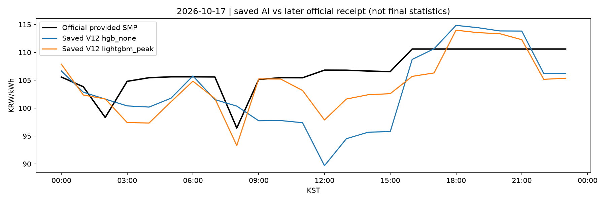
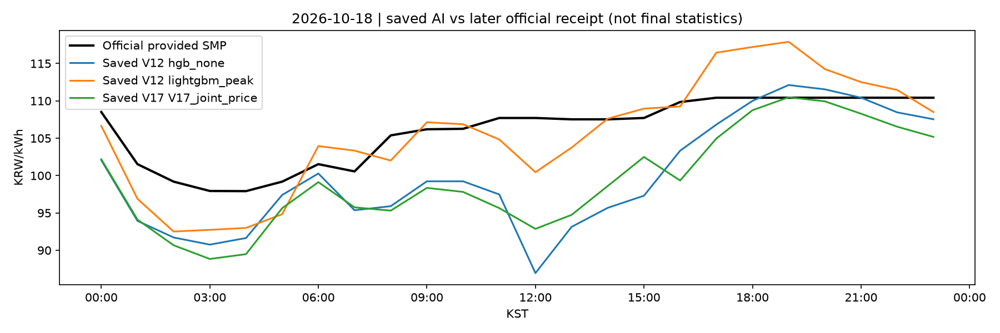
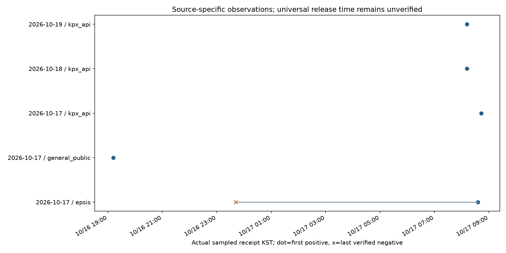

# V18 — 공개 전 AI 기록과 공개 후 SMP·EV 평가 통합

2026-10-17 KST. 기준 `98b3670`, 브랜치 `research/v18-publication-forward-integration-20261017`.

[GitHub V18 개발 브랜치](https://github.com/parksiwon22/gradproject/tree/research/v18-publication-forward-integration-20261017). 구현 체크포인트 `978e5ad`, 공개상태·충전 안정화 `de0c46d`, 결과 집계 `357d408`. 최종 보고 문서의 현재 커밋은 브랜치 HEAD에서 확인한다. 개인 계정 `parksiwon22`의 `/user` 인증을 확인했으며 공개 가능한 코드·집계·파생 그림만 저장한다.

연구 목적은 유지한다. **공식가격 공개 전 AI 예측과 충방전 계획을 실제 시각에 저장하고, 이후 공식가격으로 가격 오차·시간대 선택·비용·regret를 검증한다.** V18은 새 모델을 학습하거나 운영 모델을 교체하지 않았다. 기존 기록을 유지한 채 공개시각 관측, 발급 적격성, 통합 평가와 사용자 웹을 구현했다. 이미 공식가격을 수신한 날짜에는 새 사전 예측을 생성하지 않는다. 그 날짜의 기존 AI 예측과 EV 평가를 중단하지도 않는다.

## 1. 공식가격 경로별 검증

다음 공식 경로를 실제 요청하고 원문 해시·요청 시작/완료시각·대상일·지역·상태를 V18 폴더에 추가 저장했다. 인증키와 인증 포함 URL은 기록하지 않는다.

- [KPX SMP·수요 공식 API](https://apis.data.go.kr/B552115/SmpWithForecastDemand/getSmpWithForecastDemand): 공공 API 키로 접근하는 경로이며 회원 거래시스템 로그인과 다르다.
- [KPX 일반 공개 육지 SMP](https://www.kpx.or.kr/smpInland.es?mid=a10404080100): 인증 없는 날짜별 페이지.
- [EPSIS 시간별 SMP](https://epsis.kpx.or.kr/epsisnew/selectEkgeGepGscGrid.do?menuId=040202): 육지·제주를 별도 요청한다.
- 다른 공식 메뉴 주소 `https://www.kpx.or.kr/menu.es?mid=a10404080100`도 확인했지만 같은 smpInland 화면으로 연결돼 별도 독립 공개시계로 세지 않았다. [공식 시장가격결정 설명](https://www.kpx.or.kr/menu.es?mid=a10401040000)의 시장 가격결정 절차와 실제 API 공개 수신시각을 동일시하지 않았다.

### 확인한 최초 수신과 최신 경로 상태

|대상일|경로|확인된 최초 정상 가격 수신 KST|검증 의미|
|---|---|---|---|
|10월17일|일반 홈페이지|10월16일19:11:36|이 시각까지 일반 공개가격을 확인. D-1 23시 이전|
|10월17일|EPSIS 육지|10월17일08:35:53|더 이른 공개시각은 미확정. API/홈페이지와 동일 갱신시각을 가정하지 않음|
|10월18일|공식 API|10월17일08:11:20|D-1 23시 이전 수신. D-2 23시 이전 제공은 이 관측으로 입증 못 함|
|10월19일|공식 API|10월17일08:11:24|이 대상일의 D-2 23시보다 먼저 실제 수신|

관측 당시18·19일 일반 홈페이지는 전 시간0값 자리표시자였고 EPSIS는 정상 형식의 빈 가격목록이었다. API는 육지24시간 값을 제공했다.20일 API는 정상 `totalCount=0` 무자료, 홈페이지는0값 자리표시자, EPSIS는 정상 미관측이었다. 경로별 차이를 다른 경로의 미공개 증거로 확대하지 않는다.

17일 API는 육지와 제주를 합쳐48행을 반환했다. 첫 V18 파서는24행 전용 검증을 재사용해 거부했다. 원문을 보존한 뒤 지역별24행으로 분리하는 V18 파서와 테스트를 추가했다. 실패 이벤트는 남기고, 원수신 시각과 원문 해시를 연결한 **별도 재검증 이벤트**를 기록했다. 예측을 소급 생성하거나 원래 실패 로그를 덮어쓰지 않았다.

`V18_PUBLICATION_WINDOWS.json`은 대상일/경로/지역별 최초 정상 수신, 그 이전 마지막 정상 미관측, 실패·빈 응답·0값·부분 응답 건수를 담는다. V11/V12/V17의 과거 일반 홈페이지 파서는0값과 일부 빈 값을 모두 미관측으로 처리할 수 있어 그 음성 기록은 별도 legacy 열에 남기고 엄격한 구간 하한에서 제외했다. EPSIS의 검증된 정상 빈 격자는 정상 미관측으로 재사용한다. API에 최초 양성 수신만 있고 이전 정상 음성이 없으면 공개시각 하한은 미확정이다.

수신시각은 **그 시각까지 확인됐다는 증거**다. 정확한 최초 공개시각·회원 통지시각·최종 정정통계 확정시각은 아직 미확정이다. 샘플 사이의 캐시·정정·관측 공백도 존재한다. 특정 날 D-1 또는 D-2 기준 전에 이미 가격을 받은 경우에는 새 AI 발급을 건너뛰며, 기존에 저장한 더 이전 AI 기록의 검증은 유지한다. 연구 목적이나 평가 대상을 다른 사업으로 변경하지 않았다.

## 2. 발급 안정화와 예약작업

기존 V17의 I/O 이후5초 시각검사 오류를 재검토했다. V18은 진입 시 소급 호출을 차단하고 이후에는 실제 현재시각으로 생성 완료시각을 기록한다. I/O 중 기준 원점이 바뀌면 발급하지 않는다. 60초 이내 발급은 `on_time_within_60s`, 그 이후는 `late`이며 모델/입력 적격성도 별도로 검사한다.

기존 V12 HGB 기준 파일을 그대로 사용하고 SHA256·학습 종료2025-06-30·등록 시각을 `artifacts/v18/model_registry.json`에 불변 저장했다. 실제 등록은 **10월17일08:38:10 KST**다. 따라서 그보다 앞선16일23시의 정시 모델이라고 주장하지 않는다. 모델 등록·학습 종료·입력 최초 수신·모델 해시·세 공식 경로의 최근 공개 상태를 확인하며, 기준 이후 수신 입력으로 누락을 채우지 않는다. 불확실하거나 실패한 공개 상태도 미공개로 바꾸지 않는다.

새 발급은 가격24개, 입력 스냅샷과 수신시각, 모델 해시/등록시각, 실제 생성/지연시각, 공개 상태, 동일 EV의 G2V/V2G 계획을 하나의 불변 기록에 저장한다. 이후 평가는 원본 SHA와 공식가격 버전에 연결한 별도 파일이다. 대상일 경과에 따른 평가 단계도 구분한다. 날짜를 넘는 계획에는 실제 다음 날짜의 가격 또는 동일 기록의 예측이 있어야 하며 복제하지 않는다.

Windows 기존6개 작업을 검사했다. XML을 `artifacts/v18/scheduler/`에 먼저 보존하고 다음3개 작업의 실행 명령만 이전했다.

|기존 작업 이름|V18 실행|역할|
|---|---|---|
|GradprojectV12ForwardEV|`-m v18.service`|23시 발급+15분 관측/평가 재시도, V12 원래 평가도 유지|
|GradprojectV14Candidates|`-m v18.legacy v14`|기존 V14 사후 평가, 신규 후보 발급 없음|
|GradprojectV15Candidates|`-m v18.legacy v17`|V15/V17 기록 사후 평가와 상태 집계, 신규 후보 발급 없음|

V11 수집/기존 연구, V13 감사, V16 감사 작업은 유지했다. V12~V17 연구의 새로운 발급을 V18 하나로 모았으며 일곱 번째 중복 작업을 만들지 않았다. 작업 스케줄러의 `IgnoreNew`와 V18 파일 잠금을 함께 사용한다. 중첩 실행 테스트에서 잠긴 파일을 읽던 Windows 오류를 발견해 파일 크기 검사 후 잠그도록 수정했다.

관측 네트워크 예산은240초이며 개별 요청 제한을 합쳐 작업 제한 안에서 종료하도록 한다. 예산 이후 시도하지 못한 경로는 `deferred_budget`으로 기록하고 실패·무자료와 구분한다. 실패·빈 응답은 다음 예약 실행에서 재관측하며 무한 루프하지 않는다. 서비스 로그는 실제 실행 공백을 누락으로 기록한다. 노트북 종료·절전 중 실행은 보장하지 않는다.

기존 V11의 최근 작업 종료1은 확인했다. SMP 수집·공개 페이지·감사·가격 예측·ASOS 갱신은0이었고, 외생변수 예측 단계가 `complete as-of demand/weather inputs unavailable`로 종료했다. 이를 SMP 수집 전체 실패로 뭉뚱그리거나, 사후 기상 관측을 미래 예보로 대체해 성공으로 만들지 않았다. 기존 연구 코드는 수정하지 않았으며 해당 미완료 상태를 유지한다.

새로 확인한 공식가격은 기존 공용 가격 저장소에 **아직 없는 날짜만** 원수신 시각으로 추가한다. 기존 V11 수집기도 기공개 상태를 인식할 수 있게 하기 위함이다. 이미 있는 날짜의 가격·정정 이력은 이 경로에서 다시 적용하지 않는다. 별도 테스트로 최초 추가와 이후 정정 값 보호를 검증했다. 비어 있는 저장소를 처리하던 날짜형 오류도 이 테스트에서 발견해 수정했다. 통합 CSV 인덱스는 임시 파일 완성 후 원자적으로 교체해 웹이 쓰기 중인 파일을 읽지 않게 했다.

## 3. 전향 기록과 평가 현황

점검 시 V12 8개, V14 3개, V15 2개, V17 1개로 **기존 가격 예측 파일14개**를 읽었다. V13/V16에는 별도 새 가격 예측이 없다. V17 보조19일은 같은 원점의 D3이며 추가 독립 원점으로 세지 않는다.

|구분|실제 집계|
|---|---:|
|독립 기준시각|2개|
|독립 기본 대상일|2일:10월17·18일|
|지연 발급|14기록,2개 기준시각|
|정시 발급 기록/모델·입력까지 검증한 정시 적격 기록|0 / 0|
|공식가격 비교 완료|2개 기본 대상일|
|대상 날짜 경과 완료|0일|
|최종 정정통계 확인|0일|
|150원 이상 급등 발생 기본 대상일|0일|
|V18 새 AI 사전 예측|0개:현재 대상일은 공식가격 기수신으로 발급 생략|

기존13개 기록은 기준시각 이전 모델 고정의 충분한 메타데이터가 없어 `unknown`이다. V17 한 기록은 기준 이후 모델 고정임이 명시돼 있다. 이를 실패 모델이나 정시 전향 성공으로 임의 재분류하지 않는다. 원문에서 공식 기공개라고 표시한 항목과 실제 수신 로그의 양성 존재도 각각 관리한다. 현재14개는 발급 이전의 양성 수신을 확인하지 못했지만, 모든 공식 경로의 미공개를 인증한14개라는 뜻은 아니다.

V17 기록은18일 대상으로 **17일07:55:42**, 기준16일23시 대비535.707분 지연이다. 이 기록을 지우거나 정시로 변경하지 않았다. 현재 새 날짜/원점을 인위적으로 추가하지 않았으며 충분한 시간의 관측을 기다린다.

## 4. 동일 EV 조건의 가격·충전비용 비교

기본 비교는60kWh,초기30%→출발80%,충·방전7kW,효율각90%,SOC20~90%,열화5원/배터리 통과kWh,판매비율100%,대상일24시간 연결이다. 모든 모델의 저장 가격 벡터를 이 동일 조건으로 재생하고 공식가격 최적 G2V/V2G와 비교한다. **이는 사후 동일조건 재생이며, 당시 저장된 실제 EV 결정과는 별도 집계**다. 기존 동결 계획은 `V18_FROZEN_DECISION_COMPARISON.csv`에서 생성시각·원예측SHA·조건·추가손익을 확인한다. 개인 대화형 EV 입력은 연구 집계에 섞지 않았다.

18일 동일 대상·조건의 일부 모델은 다음과 같다. 금액은 가상 원/연결일이다. 전체 결과15행(기본14+보조1)은 `V18_MODEL_COMPARISON.csv`에 있다.

|기존 모델|MAE(원/kWh)|저가5시간 일치율|G2V regret(원)|가상 V2G 추가손익|
|---|---:|---:|---:|---:|
|V12 HGB|6.3539|60%|96.81|약0원|
|V12 LightGBM 피크|3.4509|80%|5.17|약0원|
|V14 상대 프로파일|3.9935|80%|9.07|약0원|
|V14 형상·수준 혼합|4.1369|60%|64.81|약0원|
|V15 2단계0.25|6.0635|60%|96.81|약0원|
|V17 공동 D2/D3 회귀|6.6743|60%|64.81|약0원|

이 한 날짜의 순서로 모델을 재선정하지 않았다.17일 V12 HGB MAE5.2739/regret165.59원,LightGBM3.7679/73.33원이다. 두 독립 원점과 급등0일만으로 모델 우위를 확정할 수 없다. V18 신규 학습0회, 운영 교체0회다.

급등 구간 MAE는 급등 정답이 없으면 비워둔다. 실제·예측 급등이 모두 없을 때 F1을 성공률100%로 표시하지 않는다. 피크시간 오차, 상승/하락 ramp, 가격 순위 상관, 저가5시간 일치율도 함께 기록한다. 동률 가격의 일치율은 안정적 시간순 tie-break를 사용하므로 경제적으로 같은 시간도 순위 일치율에서는 다를 수 있다. 최종 의사결정 판단에 실제 비용·regret를 우선 함께 본다.

현재 두 날짜는 가상 V2G 방전량이0kWh이고 추가손익도 수치 오차 수준0원이다. 이는 **활동 없는 해**이며 V2G 경제성 개선이 아니다. G2V 권장을 유지한다. 앞선 V17 검증의 V2G 평균 손실 결론도 바꾸지 않는다. V17의6개 연결패턴 평균 regret와 V18의24시간 한 조건 regret는 분모가 다르므로 같은 수치여야 한다고 해석하지 않는다.





## 5. V18 웹과 실행

새 `app_v18.py`, 로컬 주소 **http://127.0.0.1:8508/**. 기존8507 앱과 기존 공개 배포는 변경하지 않았다.

- **충전 추천:** 차량·SOC·전력·연결 시작/출발 날짜와 시각을 입력하면 버튼 없이 자동 계산한다. 공식가격이 전 기간 확보되면 우선 사용한다. 미확보 시 모델·입력시각을 검증한 V18 저장 예측만 자동 추천 대상으로 사용한다. 과거 실험 후보는 자동 운영 추천으로 승격하지 않는다.
- **과거 저장 예측 재생:** 실제 저장한 AI 가격을 그대로 읽고 같은 EV 조건의 즉시·균등·G2V·V2G 비용과 공식가격 기반 최적 계획을 비교한다. 새 사전 결정이라고 표시하지 않는다. 원본을 다시 최적값으로 덮어쓰지 않는다.
- **결과:** 충전 시간·전력·SOC·목표 충족·예상 절감·공식가격 평가 비용·regret·가상 V2G 추가손익/방전량을 표시한다. 날짜를 넘는 가격이 없거나 목표 충전이 불가능하면 이유를 표시한다. 사용자 저장은 개인 로컬 시뮬레이션이며 전향 표본에서 제외한다.
- **예측 검증/연구·수집:** 원본 AI와 수신 공식가격 그래프, 실제 동결 계획과 동일조건 재생의 구분, 시각 적격성·불확실성·급등 실패·V2G 손익분기·자료 최신 상태를 통합했다. 탭을 버전별로 늘리지 않았다.

교수님 시연은 기본 야간18~다음날08시 공식가격 최적화 → 과거 저장 예측 재생 → 예측 검증의 동일조건 비용/regret 순서로 진행한다. 과거 시연을 현재 AI 미래예측으로 표시하지 않는다.

프로젝트 폴더에서 실행:

```powershell
..\.venv\Scripts\python.exe -m pip install -r requirements-v16.txt
..\.venv\Scripts\python.exe -m v18.forward
..\.venv\Scripts\python.exe -m v18.service
..\.venv\Scripts\python.exe -m v18.reporting
..\.venv\Scripts\python.exe -m streamlit run app_v18.py --server.address 127.0.0.1 --server.port 8508
..\.venv\Scripts\python.exe -m unittest discover -s tests -v
..\.venv\Scripts\python.exe -m scripts.smoke_v18
```

별도 학습 명령은 없다. 최초 모델 등록은 실제 실행시각에 이뤄져 이전 원점으로 소급하지 않는다. 로컬 V11 가격DB·기존 모델·예측 파일이 필요하다. 키 없이 기존 자료 웹·최적화·평가·일반 공개 페이지/EPSIS 관측이 가능하다. 공식 인증 API 수집에는 Windows `KPX_SERVICE_KEY`가 필요하며 기상청 키와 혼용하지 않는다.

## 6. 검증과 남은 관측

테스트 및 자산 해시 검증은 `V18_VALIDATION.json`, 예약작업은 `V18_SCHEDULER_STATUS.json`에 기록한다. 가격/지역/시간 분리, 실패·빈 값·자리표시자와 정상 무자료 구분, 공개시각 구간, 모델 고정·입력 수신시각, 과거 발급 차단, 기공개가격 생략, 불변 예측, 동일 EV 최적 비용, 음수가격·부분 시간·SOC·동시 충방전, 중복 실행, 관측 예산, 웹 자동계산·재생·저장·새로고침과 HTTP를 검증했다. 첫 잠금 테스트 실패와48행 API 파서 실패를 수정했으며 원래 실패 로그도 보존했다. 처음 수동 UI 점검은 라디오 순서를 잘못 지정한 테스트 코드 오류였고, 라벨로 선택하도록 고쳤다.

최종 **112개 테스트 통과, 실패0·오류0·생략0**(기존98개+V18 14개). 공식가격 공유의 빈 저장소 오류를 수정한 뒤 전체를 재실행했다. 기존 모델·불변 예측/의사결정·V5 입력·ZIP3개 등을 포함한 **824개 보호 자산의 SHA256 차이0**, 기존 V5~V17 소스 차이0을 확인했다. 이전한 예약작업3개를 실제 스케줄러로 실행해 종료코드0을 확인했고, V18 서비스 전체 단계와 실제 HTTP health200도 통과했다. 정시23시 실행 자체와 이후 새 독립 예측 성능은 아직 관측 대기다.

Git에는 소스·집계·파생 그림만 포함한다. API 키·인증정보·원문·SQLite·모델 바이너리·개인 EV 입력·ZIP은 제외한다. 기존 V5~V17 코드·운영 모델·불변 예측·ZIP은 보존한다. 연구 중 자동 수집의 정상 자료 추기와 정정 관측은 계속된다.

미완료는 실제 정시 적격 발급의 장기 관측, 모든 경로의 최초 공개시각 확정, 대상일 경과 및 최종 정정통계 확인, 급등을 포함한 충분한 독립 표본, 당시 발표된 수요·기상·공급 원본이다. 이들은 시간 경과나 새로운 자료가 필요하다. 기존 AI와 공식가격·EV 비용을 비교하는 연구 목적은 유지하며, 미확인 결과를 성공으로 채우지 않는다.
