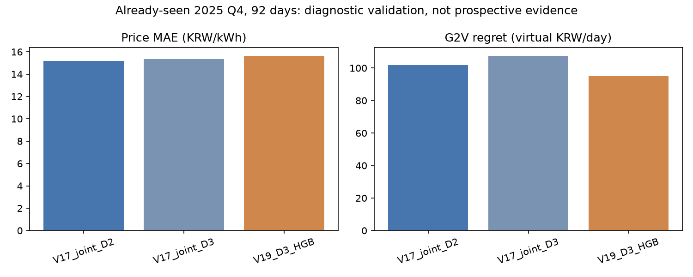
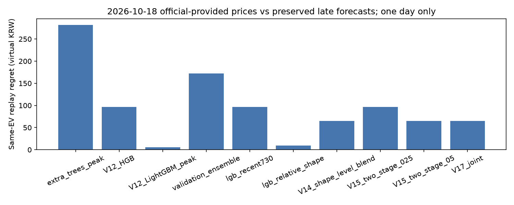

# V19: 정시 사전 예측과 공식가격·EV 비교

2026-10-17 낮(KST) 실행 결과. 기준 V18 `f07a3e0`, 개발 브랜치
`research/v19-timely-d2-d3-20261017`. 연구 목적은 **공식 공개 전 저장한 AI 예측과 이후 공식 SMP를 비교하고, 고정한 EV 계획의 실제 가상 비용을 검증하는 것**이다.

## 1. 완료 범위와 실제 발급 상태

- 신규 실제 사전 예측 **0건**, 신규 정시 적격 발급 **0건**. 실제 23시가 아직 도래하지 않았다.
- 10월 17일 23시 기준 / 10월 20일 대상 D-3 **2개 준비본**: V17 joint, V19 별도 D3 HGB. 준비본은 발급된 예측이 아니다.
- 같은 기준의 D-2 / 10월 19일은 공식가격을 이미 확보했으므로 준비·발급하지 않는다.
- 10월 20일 API 정상 무자료, EPSIS 미관측, 일반 홈페이지 **모두 0원 응답은 공개상태 미확인**이다. 이 상태가 23시까지 계속되면 발급을 보류한다. API의 빈 응답·실패를 미공개로 간주하지 않는다.
- D-3도 모든 공식 경로보다 빠르다는 보장은 없다. 관측한 경로의 음성 증거만 사용하며 보편적 최초 공개시각을 주장하지 않는다.

현재 상세 상태: [V19_STATUS.json](V19_STATUS.json). 시각은 상태 파일의 수신시각과 함께 읽는다. 낮에 확인한 상태를 23시의 최신 상태로 재사용할 수 없다.

## 2. 지연 원인과 처리 순서 개선

이전 경로는 공개상태 API 조회, DB 이력 조회, 모델 로딩·추론, EV 최적화가 발급 경로에 결합되어 있었다. 수초의 허용창과 긴 네트워크 호출이 충돌했다. V19는 다음과 같이 분리했다.

1. `v19.models`: 기존 모델을 재사용하고 모델 파일 SHA-256, 허용 지평, 버전을 등록. 실제 잠금시각 **10월 17일 12:20:13 KST**.
2. `v19.observer`: 느린 공식 경로 조회·수집, 적격 수신본 스냅샷, 추론과 EV 계획 계산, 기존 예측 사후 평가.
3. `v19.preparation`: 기준시각 이전 실제 수신본만으로 준비 패킷 저장. 모델/입력/준비 완료가 모두 기준시각보다 빨라야 한다. 최초 수신시각이 스냅샷보다 늦은 자료는 거부한다.
4. `v19.publisher`: **네트워크, 모델 추론, EV 계산 없이** 준비본과 모델 해시, 공개상태 요약 및 로컬 DB 양성 여부만 재검증하고 불변 발급한다.

발급 파일에는 실제 계산시각, 입력 스냅샷·최대 최초 수신시각, 모델 등록시각과 해시, 실제 발급시각 및 지연시간, 공개상태 근거, EV 계획을 함께 저장한다. 별도 불변 commit 파일은 파일 생성 후 관측한 완료시각과 해시를 기록한다. 완료가 기준시각 이후 **60초 이내**인 경우만 정시로 분류하며 그 이후는 지연 발급이다. 기준시각 이후 학습·고정된 모델은 허용하지 않는다. 빠른 기록 시간만으로 모든 공식 경로보다 선행했다고 확정하지 않는다.

발급 시 공개상태는 세 경로 모두 180초 이내의 검증 가능한 정상 미관측이어야 한다. 한 경로라도 이미 가격을 확보했거나, 실패·미확인·모두 0원 응답·오래된 조회이면 차단한다. 양성 수신 이력은 이후 빈 응답으로 지우지 않는다. 기준시각 전에 준비한 패킷이 없으면 과거 발급을 소급 생성하지 않는다.

실제 예약작업 수동 실행에서 수집 16.09초, 추론·EV 준비 단계 2.48초, 기존 예측 평가 7.56초였다. D3 모델별 추론은 약 0.07~0.08초, EV 계산 약 0.02초였다. 이는 낮의 처리시간이며 **실제 23시 정시 발급 성적이 아니다**. 모의 발급 테스트는 임시 디렉터리에 `SIMULATION_ONLY`로 저장하고 실제 전향 집계에서 제외한다.

## 3. 예약작업

- 기존 `GradprojectV12ForwardEV`를 `v19.observer`로 안전하게 이전하고 원래 XML은 로컬 백업했다. 15분 간격 및 22:50·22:58 준비 실행.
- `GradprojectV19Publish`: 22:59:30 준비 기동 후 실제 23시 대기, 23:00 기동 실패 대비, 23:02 지연 재시도. `IgnoreNew`와 별도 발급 잠금으로 동시 실행 차단.
- V11 수집, V13 감사, V14/V17 읽기 전용 비교, V16 감사 작업은 유지한다. 기존 작업이 별도 신규 AI 발급을 중복 수행하지 않도록 실행 경로를 검사했다.
- 실제 작업 스케줄러로 두 V19 경로를 실행했다. 수집·준비·평가는 완료했고, 낮의 발급 작업은 **허용 실행창 밖이므로 정상 건너뜀**을 기록했다. 작업 종료코드 0은 정시 예측 성공을 의미하지 않는다.
- 마지막 확인에서 관련 7개 작업 모두 Ready, 마지막 종료코드 0이었다. 이는 향후 실행 보장이 아니라 확인 시점의 작업 상태다.
- 중단·오류는 시작/실패 기록과 수집 간격 누락으로 보존한다. 노트북 종료·절전에서는 실행을 보장하지 않는다. 깨어난 뒤 과거 시각을 정상 실행으로 복원하지 않는다.

## 4. D-2 / D-3 후보: 신규 학습 1회

기존 8개 등록 항목(고유 모델 파일 7개), 지평 포함 9개 조합을 실제 추론 검증했다. V12 HGB·LightGBM peak, V14 shape/level blend, V15 2단계 혼합 0.25/0.5, V17 joint·충전 순위 혼합, 신규 V19 D3다. V17 순위 혼합은 동일 가격 회귀에 충전 우선순위를 결합한 정책이며 새로운 가격 모델 우위로 중복 계산하지 않는다.

가설: D2/D3 공동 학습의 간섭을 줄이기 위해 D3만 별도 잔차 학습하면 EV 순서 선택이 개선되는지 확인한다. 점수를 보기 전 12:20:00 KST에 가설·설정·선정 기준을 불변 저장했다. HGB 200회, 31 leaves, 학습률 0.05, early stopping 비활성, seed 42, 기존 가격 기반 21개 피처. 새 외생자료를 확보했다고 주장하지 않는다. 피처 정의는 `v11.features.FEATURES`, 기준시각별 구성은 `v17.features.build`를 재사용한다. 목표일 실제 SMP는 입력에서 제외한다.

학습: 2023-01-01~2025-06-30. 비교: **이미 열람된** 2025-10-01~12-31, 92일. 2026년 10월은 모델 선정에서 제외했다. 이 비교도 새 독립 테스트나 당시 자료 수신본을 입증한 전향 검증은 아니다. 기존 V17의 후속 보정·선정 이력을 포함한 모델은 그대로 재사용했다.

| 모델 | 지평 | MAE 원/kWh | 고가 MAE | 고가 F1 | 저가5시간 일치율 | G2V regret 원/일 | V2G 추가손익 원/일 | 방전 kWh/일 |
|---|---:|---:|---:|---:|---:|---:|---:|---:|
| V17 joint | D2 | 15.1652 | 32.6769 | 0.1429 | 71.52% | 101.86 | -46.16 | 6.31 |
| V17 joint | D3 | 15.3282 | 29.8384 | 0 | 73.91% | 107.36 | -62.13 | 6.38 |
| V19 별도 HGB | D3 | 15.6198 | 30.4687 | 0 | 75.00% | 94.96 | -54.47 | 5.78 |

고가 기준 150원/kWh, 실제 고가 **7시간**뿐이다. 피크 MAE는 실제 고가 시간수 가중, F1은 전체 TP/FP/FN 합계로 계산했다. 일별 비율 평균을 전체 F1로 오인하지 않는다. 초기 집계 오류 수정 전 상세 결과는 로컬에 보존했으며 수정은 추론·집계 재계산이고 추가 학습은 아니다.

D3 joint는 D2 joint보다 MAE 약 1.07%, regret 약 5.40% 악화했다. 별도 D3는 joint D3 대비 MAE 1.90% 악화, G2V regret **11.55% 감소**했다. 사전 기준(MAE 악화 5% 이내 + regret 개선 5% 이상)을 통과하여 **전향 비교용 shadow 후보만 보존**했다. 급등 추종 개선은 확인되지 않았으며 운영 모델은 교체하지 않는다.

상세 RMSE·피크시각·상승/하락 ramp·경제성: [V19_D3_HISTORICAL_COMPARISON.csv](V19_D3_HISTORICAL_COMPARISON.csv).



## 5. 기존 실제 저장 예측의 공식가격 비교

V12~V17 기존 실제 파일 **14개**, 독립 기준시각 **2개**, 주 대상일 **2일**을 재검증했다. V17 파일에 포함된 보조 D3 10월 19일까지 공식 제공가격 비교는 3일이다. 모두 지연 발급이며, 기존 V17은 기준시각 이후 모델 고정 문제도 있다. 기존 파일을 정시로 재분류하지 않는다.

기준시각은 같아도 실제 발급시각과 모델 자격이 다르므로 아래는 동일 조건의 정시 실험이 아닌 **보존 기록 진단표**다. 공식 제공가격은 수신했으나 대상일 경과 완료 **0일**, 최종 정정통계 확인 **0일**, 급등 발생 대상일 **0일**이다. 실제 수급 결과의 최종 확인까지 끝났다고 표시하지 않는다.

10월 18일, D2 보존 가격을 동일 EV 조건으로 다시 계산한 비교:

| 모델 | MAE 원/kWh | 공식가격 기준 G2V 비용 원 | G2V regret 원 | 저가5시간 일치율 |
|---|---:|---:|---:|---:|
| V12 HGB | 6.3539 | 3,542.81 | 96.81 | 60% |
| V12 LightGBM peak | 3.4509 | 3,451.17 | 5.17 | 80% |
| V14 relative shape | 3.9935 | 3,455.07 | 9.07 | 80% |
| V14 shape/level blend | 4.1369 | 3,510.81 | 64.81 | 60% |
| V15 혼합 0.25 | 6.0635 | 3,542.81 | 96.81 | 60% |
| V15 혼합 0.5 | 5.8079 | 3,510.81 | 64.81 | 60% |
| V17 joint | 6.6743 | 3,510.81 | 64.81 | 60% |

조건: 60kWh, SOC 30→80%, 충전·방전 최대 7kW, 효율 각각 90%, SOC 범위 20~90%, 열화 5원/배터리 방전kWh, 가상 판매 정산비율 1, 24시간 연결. 공식가격 G2V 최적 3,446.00원, 즉시충전 3,522.43원, 균등충전 3,684.99원. V12 LightGBM은 이 비교에서 각각 약 71.26원·233.81원 절감했다. 하루 진단으로 모델 우위를 확정하지 않는다.

같은 날짜의 위 예측에서는 가상 V2G의 추가 방전이 0으로 추가손익도 사실상 0이다. 이를 V2G 개선이라고 해석하지 않는다. 과거 92일 비교에서도 추가손익은 음수이므로 **G2V 기본 권장**을 유지한다. 비용은 실제 국내 EV 소매요금이나 실증 판매수익이 아닌 SMP 연동 가상 정산이다.

`V19_MODEL_COMPARISON.csv`는 동일 EV 조건 재계산이고, `V19_FROZEN_EV_COMPARISON.csv`는 **원래 보존된 계획 그대로** 공식가격에 평가한 별도 표다. 원결정이 원예측 발급보다 늦게 저장된 경우 `decision_frozen_by_issue=False`로 표시한다. 실제 사전 결정으로 소급 인정하지 않는다.

실제 동일 날짜·동일 모델 해시의 D2/D3 쌍은 **0개**다. 10월 19일 기존 D3 MAE 9.8327, G2V regret 0은 다른 날 D2와 직접 비교하지 않는다. [V19_PAIRED_HORIZONS.csv](V19_PAIRED_HORIZONS.csv)에 누락을 그대로 표시했다.



## 6. 웹 및 실행

V18 코드를 보존하고 `app_v19.py`를 추가했다. 로컬 실행 주소: **http://127.0.0.1:8509/**. 기존 공개 웹은 변경·재배포하지 않았다.

- 동일 날짜 D3/D2/공식가격 그래프, 모델·실제 발급시각·기준시각, 비용·SOC·충전전력 비교.
- 10월 18일 예제의 D3, 19일 예제의 D2는 **미확보**로 표시한다. 대체 곡선을 만들지 않는다.
- 예측·공식가격 기반 동일 EV 재계산과 원래 고정된 EV 결정의 사후 평가를 구분한다.
- 배터리·SOC·연결시각·충방전·효율 입력, 실제 2일 가격이 있을 때 날짜 경계 최적화. 두 번째 날짜가 없으면 실패를 표시하며 앞날 가격을 복사하지 않는다.
- V17 순위 기반 계획은 가격 자체와 충전 우선순위의 차이를 명시한다. 서로 다른 기준시각·모델 해시의 밤샘 예측을 임의 결합하지 않는다.
- 연구 화면의 준비본은 실제 발급 기록과 분리한다. 발표용 과거 시뮬레이션 저장도 `RETROSPECTIVE_INTERACTIVE_NOT_NEW_FORWARD`로만 저장한다.

PowerShell, 프로젝트 폴더에서:

```powershell
..\.venv\Scripts\python.exe -m v19.models
..\.venv\Scripts\python.exe -m v19.observer
..\.venv\Scripts\python.exe -m v19.evaluation
..\.venv\Scripts\python.exe -m v19.reporting
..\.venv\Scripts\python.exe -m streamlit run app_v19.py --server.port 8509
..\.venv\Scripts\python.exe -m unittest discover -s tests -v
..\.venv\Scripts\python.exe -m scripts.smoke_v19
```

설치 라이브러리는 기존 `requirements-v16.txt`를 재사용한다. 모델 명령은 저장된 결과가 있으면 추가 학습하지 않는다. 예약작업 설치는 `scripts/schedule_v19.ps1 -Install`; 실제 발급 진입점은 `-m v19.publisher --warm`이다. 이 명령도 실제 시각을 사용하며 낮에는 발급하지 않는다. API 인증키는 기존 Windows 사용자 환경변수에서만 읽는다.

## 7. 검증·보존·미완료

전체 **124개 테스트 통과**, 114.610초: 기존 112개 + V19 12개. 입력시각/목표일 실제값 차단, 9개 모델·지평 추론, 정시 모의 기록/지연/공식가격 보유 차단, 패킷·모델 해시 변경 거부, 불변성, 23시 후 fallback, EV 물리·경제성·날짜 경계 기존 회귀, UI 날짜·페이지 전환·저장·새로고침을 검증했다. Streamlit HTTP health **200 ok**. 초기 테스트 fixture의 Timestamp 직렬화 오류와 UI ROOT import 누락, 평가 중 중복 메타 키 오류는 수정 후 재검증했다.

HTTP smoke 명령은 패키지 경로를 인식하는 `-m scripts.smoke_v19`로 확인했다. 제한 환경의 로컬 서버 smoke는 timeout이 발생했으며, 로컬 통신이 허용된 실제 실행에서 HTTP health OK 및 서버 종료를 확인했다.

보호 대상 **840개 파일 SHA-256 일치**, 변경 0개. 기존 V5~V18 소스, 불변 예측·모델·원자료·ZIP은 보존했다. 공개 Git에는 소스·집계 보고·집계 그래프만 저장한다. 원시 시간별 비교 그래프는 `artifacts/v19/figures/`, 모델·준비본·원결정·수신 원문·스케줄러 XML·실행 로그도 `artifacts/` 로컬에만 보존한다. 인증키와 개인 입력은 공개하지 않는다.

**미완료**: 실제 23시 발급, 10월 20일 공식가격 미확인 상태 해소, 동일 대상일 D2/D3 독립 쌍 축적, 급등 포함 충분한 전향 표본, 대상 날짜 경과 및 최종 정정통계 확인. 홈페이지 0원 응답을 정상 미공개로 인증할 근거가 없으므로 이 문제가 남으면 적격 발급도 보류한다. 새 모델의 미래 우위·정시 발급 성공·V2G 경제성 개선은 아직 주장하지 않는다.

저장소: [V19 연구 브랜치](https://github.com/parksiwon22/gradproject/tree/research/v19-timely-d2-d3-20261017). 운영 모델 교체·main 병합·공개 배포 없음.
