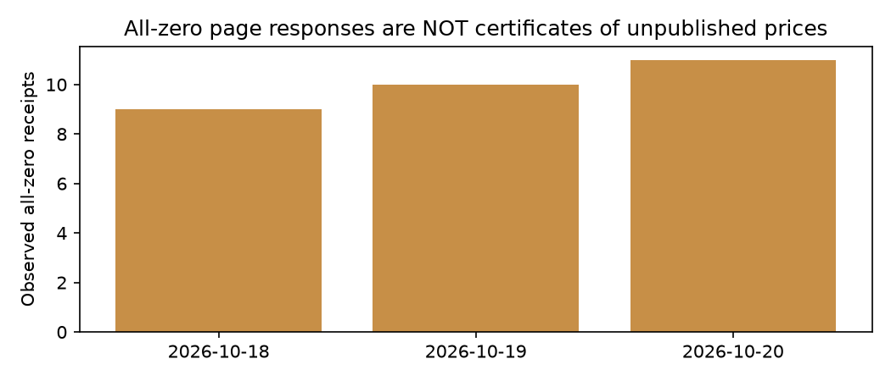
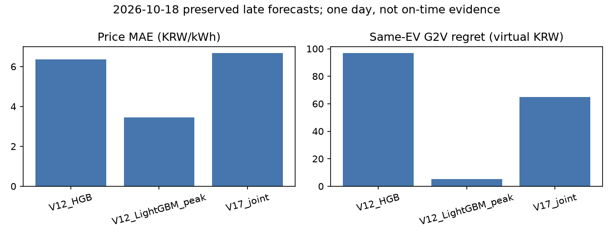

# V20 실제 발급 감사와 AI·공식 SMP/EV 통합

2026-10-17 낮 KST 실행 결과. 기준 V19 `02b5819`, 개발 브랜치 `research/v20-issuance-auto-ev-20261017`.
공식가격 공개 전 저장한 AI 예측을 이후 공식 SMP 및 동일 EV 조건의 충방전 비용과 비교한다는 연구 목적을 유지했다. 새로운 학습·운영 모델 교체·공개 웹 재배포는 없다.

## 실제 사전 발급 상태

- **신규 실제 발급 0건, 신규 정시 적격 0건**. 실제 22:50·22:58·23:00은 아직 도래하지 않았다. 낮의 작업 실행과 모의 테스트를 정시 발급 성공으로 인정하지 않는다.
- 10월 17일 23시 기준 D2 대상 19일은 공식가격 기확보로 발급 금지. D3 대상 20일은 2개 모델의 미발급 준비본만 있고 홈페이지 공개상태 미확인으로 보류한다.
- 기존 실제 보존 예측 14개, 독립 기준시각 2개, 주 대상일 2일. 보조 D3를 포함한 공식 제공가격 비교 날짜는 17·18·19일이다. 대상일 경과 완료·최종 정정통계 확인·급등 대상일은 각각 0일이다.
- 동일 대상일·동일 모델 해시의 실제 D2/D3 쌍은 아직 0개다. 한 지평이 없는 날짜는 미확보로 표시한다.

V19의 모델 등록·입력 스냅샷·사전 준비·단일 발급기를 그대로 사용한다. 모델은 10월 17일 12:20:13 KST에 고정됐으며, 실제 발급 때 모델·패킷 해시와 입력 수신시각을 재검증한다. 네트워크·추론·EV 최적화는 발급 경로 밖에서 수행한다. 완료시각이 기준시각 이후 60초를 넘으면 지연, 모델 고정이나 입력 적격성이 확인되지 않으면 정시 적격에서 제외한다. 원래 가격과 EV 계획은 바꾸지 않고 공식가격 수신 후 별도 평가 파일을 저장한다.

V12 HGB/LightGBM peak는 D2, V17 joint는 D2/D3, V19 별도 HGB는 D3만 지원한다. 지원하지 않는 지평을 새로 만들지 않았다. 기존 V14/V15 연구 비교도 보존했다.

## 0원 응답: 실제 대조와 판정

공식 경로를 실제 재요청해 원문·수신시각·해시를 보존했다. 다음은 10월 17일 12:47~12:48 KST 관측이며 보편적 최초 공개시각이 아니다.

| 대상일 | KPX API | 일반 홈페이지 | EPSIS 육지 |
|---|---|---|---|
| 10월 18일 | 정상 24시간 가격 | 24시간 모두 0원 | 정상 미관측 |
| 10월 19일 | 정상 24시간 가격 | 24시간 모두 0원 | 정상 미관측 |
| 10월 20일 | 정상 응답·자료수 0 | 24시간 모두 0원 | 정상 미관측 |

API 최초 정상 수신은 보존 로그에서 18일 대상 **10월 17일 08:11:20 KST**, 19일 대상 **08:11:24 KST**다. 그보다 앞선 보편적 공개시각이나 거래시스템 통지시각을 확정하지 않는다. 실제 경로별 마지막 정상 미관측과 최초 정상 수신은 `V20_PUBLICATION_OBSERVATIONS.csv`에 분리했다. 실패·오래된 응답·legacy 파서의 모호한 음성 판정을 정상 미관측에 합치지 않았다.

독립 표 파싱으로 **행 24개, 대상 날짜와 마지막 열 일치, 셀의 숫자 0**을 확인했다. 따라서 마지막 열 숫자를 읽는 단순 파싱 오류로 설명되지는 않는다. API에서 이미 정상가격을 받은 18·19일에도 홈페이지가 0원을 반환하므로 이 응답을 실제 0원 가격이나 미공개 증명으로 사용하면 안 된다. 자리표시자·경로별 갱신 지연 가능성은 있지만 정확한 원인은 확인되지 않았다.

[KPX 육지 공식 조회](https://www.kpx.or.kr/smpInland.es?mid=a10404080100), [EPSIS 공식 SMP 조회](https://epsis.kpx.or.kr/epsisnew/selectEkmaSmpSmpChart.do?menuId=050201)를 조사했으나 이번 확인에서 **24시간 0원=공식 미공개**라는 명시적 정의를 확보하지 못했다. 실제 원문 증거가 문서상의 공개 규정과 동일하다고 주장하지 않는다. 가격 공개 이후 홈페이지가 정상 숫자로 전환되는지 후속 관측도 기록하되, 아직 전환이 관측되지 않은 날짜에 전환했다고 보고하지 않는다.

**안전검사는 유지했다.** 모두 0원이면 `unverified_all_zero`이며 적격 발급을 보류한다. 20일 API 무자료만으로 전체 경로 미공개를 인증하지 않는다. 23시에도 이 상태라면 발급에 실패할 수 있고 그 사유를 그대로 기록한다. 독립 파서 결과는 `V20_ZERO_GRID_AUDIT.json`에 원문 해시와 함께 저장했다.



## 예약작업과 실패·누락 관측

기존 `GradprojectV12ForwardEV`의 실행 명령만 `-m v20.service`로 이전했다. 원래 XML은 로컬 백업했고 트리거·설정은 유지했다. 서비스는 V19 수집·준비·평가를 먼저 실행한 뒤 V20 읽기 전용 감사를 갱신한다. 단계별 성공/실패를 불변 `service_runs`로 남기며 실패 시 작업 종료코드도 실패로 반환한다.

기존 단일 `GradprojectV19Publish`는 그대로다. 22:59:30 준비 기동, 23:00 fallback, 23:02 지연 재시도 및 중복 실행 잠금을 유지한다. 수집은 15분 간격과 22:50·22:58 준비 트리거를 유지한다. 새 발급 작업을 추가하지 않았다.

실제 Windows 작업으로 수집과 발급 핸들러를 실행했다. 수집·평가·감사는 완료, 낮의 발급은 허용창 밖이므로 건너뛰었다. 관련 7개 작업의 확인 시점 상태는 Ready/마지막 결과 0이었다. 향후 정시 성공 보장이 아니다. 발급 후 새 예측 파일·commit 완료시각이 있어야 정시 성공을 인정한다.

V20은 22:50·22:58·23:00 예정시각과 실제 worker 관측을 구분한다. 자정이 지나도 시스템 활성화 이후 과거 날짜의 누락을 계속 표시한다. 관측이 없으면 종료·절전·오류 중 무엇인지 임의 확정하지 않고 `missing_unverified_sleep_or_failure`로 남긴다. 노트북 종료·절전에서는 실행을 보장할 수 없다.

## EV 자동 자료 선택과 원계획 보존

새 `select_auto`는 다음 순서로 선택한다.

1. 차량 연결기간 **전체** 공식가격이 있으면 공식가격.
2. 없으면 모델 사전 고정·입력 수신시각·정시 발급·발급 당시 공식가격 미확보가 검증된 **저장 AI**.
3. 둘 다 없으면 수신 대기와 사유 표시.

AI는 과거 점수를 보고 고르지 않고 최신 적격 기준시각·발급시각 및 고정된 정렬 순서로 선택한다. 연구 저장 예측을 활용하는 화면상의 충전 시뮬레이션이며 운영 모델 자동 승격이 아니다. 지연·자격 미확인·미발급 준비본은 자동 추천에서 제외한다. 다만 연구 비교 화면에서는 기존 지연 기록을 명확히 표시하고 계속 비교할 수 있다.

공식/AI를 임의 혼합하거나 다음 날짜를 복제하지 않는다. 밤샘 AI는 같은 기준시각·같은 모델·같은 해시의 진짜 두 날짜가 있어야 한다. 중복 시간 가격이 충돌하면 선택하지 않는다. 연결기간 가격이 부족하거나 목표 SOC가 불가능하면 오류·대기를 표시한다.

현재 차량 조건으로 다시 계산한 계획과 **발급 당시 동결한 계획**은 별도 표다. 동결 계획은 그대로 공식가격에 점수만 매기고 최적화해서 덮어쓰지 않는다. 새 사용자 시뮬레이션 저장은 V20 로컬 `RETROSPECTIVE_INTERACTIVE_NOT_NEW_FORWARD` 기록에만 남긴다.

공식가격이 없어도 선택한 AI 가격 기준으로 즉시·균등·G2V·가상 V2G 예상 비용을 비교한다. 공식가격이 전체 도착하면 같은 계획의 사후 가상 비용과 공식가격 최적 대비 regret를 별도로 표시한다. 즉시·균등 계획은 가격과 무관한 동일 전력 계획이므로 사후 비용만 실제가격으로 다시 계산한다.

## 모델과 경제성 결과

V20 신규 모델 학습 **0회**. 기존 2026년 결과를 보고 재튜닝하지 않았다. 아래는 10월 18일 기존 지연 예측을 동일 차량 조건으로 비교한 결과이며, 새 독립 전향 성공이 아니다.

| 모델 | 지평 | MAE 원/kWh | G2V 공식가격 비용 원 | G2V regret 원 | 저가5시간 일치율 |
|---|---|---:|---:|---:|---:|
| V12 HGB | D2 | 6.3539 | 3,542.81 | 96.81 | 60% |
| V12 LightGBM peak | D2 | 3.4509 | 3,451.17 | 5.17 | 80% |
| V17 joint | D2 | 6.6743 | 3,510.81 | 64.81 | 60% |

60kWh, 초기/목표 SOC 30/80%, 7kW, 충방전 각 효율 90%, SOC 20~90%, 열화 5원/배터리 통과kWh, 판매 정산비율 1, 하루 24시간 연결. 공식가격 G2V 최적 **3,446.00원**, 즉시 **3,522.43원**, 균등 **3,684.99원**. LightGBM G2V는 즉시 대비 71.26원, 균등 대비 233.81원 절감했다. 해당 비교의 V2G 추가 방전과 추가이익은 사실상 0이다. 방전하지 않은 결과를 V2G 개선으로 주장하지 않으며 **G2V 기본 권장**을 유지한다.

19일 기존 D3 V17은 MAE 9.8327, regret 0이지만 다른 날짜의 D2와 직접 대조하지 않는다. V19 D3 후보는 아직 실제 발급·평가가 없으므로 새 미래 MAE를 제시하지 않는다. 고가 발생일이 없으므로 급등 추종 우위를 확정할 수 없다.

가격 오차·RMSE·저가시간·급등·ramp·가상 V2G 지표는 `V20_MODEL_COMPARISON.csv`, 원래 고정된 결정의 사후 비용은 `V20_FROZEN_EV_COMPARISON.csv`다. 원결정이 발급보다 늦게 생성된 경우도 해당 컬럼에 그대로 표시한다. 모두 SMP 연동 가상 정산이며 실제 국내 EV 소매요금·실증 판매수익이 아니다.



## V20 웹과 재실행

로컬 주소 **http://127.0.0.1:8510/**. 기존 8509 및 공개 웹은 보존했다.

- **SMP 예측·공식가격 비교**: 같은 대상일 D3/D2/공식 곡선, 시간별 오차, 모델별 가격·저가시간·EV 비교, 원동결 계획의 평가.
- **EV 충전 추천**: SOC·시작/출발 시각 입력 즉시 전체기간 공식가격/적격 저장 AI/대기를 자동 선택하고 전력·SOC·비용 비교. 과거 포함 조건은 시연·재계산으로 표시.
- **연구 결과·시스템 상태**: 신규 실제 발급·독립 대상일·날짜 경과·급등 수, 홈페이지 0원 보류 사유, 단계별 실행·실패·누락·갱신시각. 준비본과 발급 기록을 분리.

프로젝트 폴더 PowerShell:

```powershell
..\.venv\Scripts\python.exe -m v20.service
..\.venv\Scripts\python.exe -m streamlit run app_v20.py --server.port 8510
..\.venv\Scripts\python.exe -m unittest discover -s tests -v
..\.venv\Scripts\python.exe -m scripts.smoke_v20
..\.venv\Scripts\python.exe -m v20.reporting
```

기존 가상환경과 `requirements-v16.txt`를 재사용한다. 예약작업 이전 명령은 `scripts/schedule_v20.ps1 -Install`이며 기존 모델을 다시 학습하지 않는다. API 수집에는 기존 환경변수가 필요하다. 저장된 공식/AI 비교와 충전 시뮬레이션은 API 키 없이 가능하다. 원자료·모델·예측 기록은 Git에 없으므로 기존 로컬 자산이 필요하다.

## 검증과 남은 사항

테스트 수·실행시간·원로그 해시는 `V20_VALIDATION.json`을 기준으로 한다. 기존 회귀 전체와 V20 자동선택·기공개 차단·시각·두 날짜/동일 해시·중복충돌·0원 열 감사·자정 누락·UI 공식/AI/대기·저장·새로고침을 실행했다. 실제 HTTP health 200과 임시 서버 smoke OK를 확인했다. AI 선택 분기 모의 테스트는 실제 사전 발급으로 집계하지 않는다.

최종 전체 **136개 통과(117.087초)**, 별도 V20 12개 재검증도 통과했다. 보호 대상 **848개 파일 SHA-256 일치, 변경 0개**. 기존 V5~V19 소스 변경도 없음을 Git diff로 확인했다. 실제 시간별 가격·충전전력·SOC 시연 그래프는 로컬 `artifacts/v20/figures/20261018_price_charge_soc.png`에 저장하고 공개 Git에서는 제외했다.

초기 V20 감사에서 중복 메타 키로 실패한 부분을 수정 후 실제 서비스·테스트를 재실행했다. 추가 테스트에서 UTC+09:00과 Asia/Seoul의 시간대 혼용 오류를 수정했고, UI 테스트가 날짜 위젯 허용 범위 밖의 2040년을 넣던 부분도 수정했다. 실패 로그는 로컬에 보존했다. EV 기본 비교의 반환 형식을 확인하여 즉시/균등 비용 재계산을 기존 함수 계약에 맞췄다. 원래 파일은 수정하지 않았다. 보호 파일 해시는 `V20_STATUS.json`과 `V20_VALIDATION.json`에 기록한다.

**미완료**: 실제 23시 발급 결과, 홈페이지 0원 의미 및 갱신 전환 관측, 같은 날짜 D2/D3 독립 쌍, 급등 포함 충분한 전향 표본, 날짜 경과·최종 정정통계 검증. 그 결과를 기다려야 모델·V2G 경제성의 미래 개선을 판단할 수 있다.

GitHub: [V20 연구 브랜치](https://github.com/parksiwon22/gradproject/tree/research/v20-issuance-auto-ev-20261017). 공개 대상은 소스·집계·집계 그래프뿐이며 API 키·원자료·모델 바이너리·개인 EV 기록·ZIP은 제외한다.
