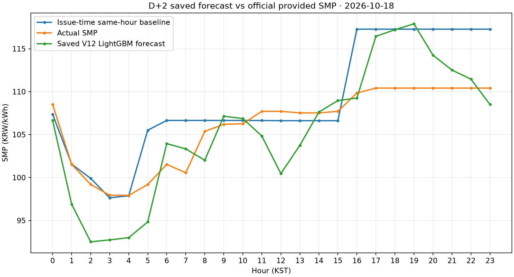
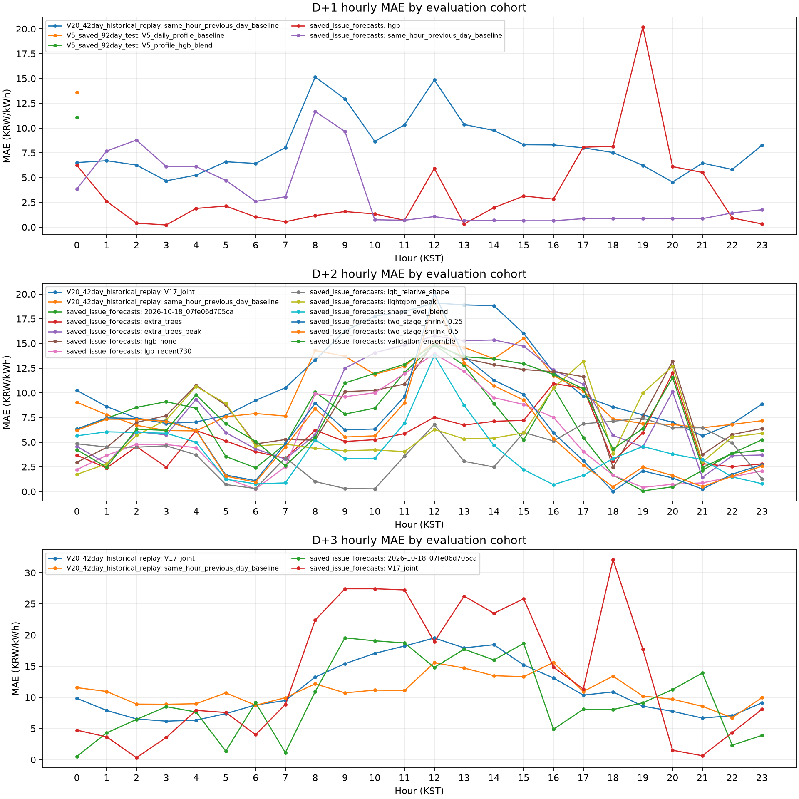
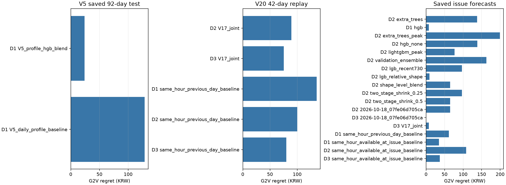

# 전력예보 졸업작품 최종 결과 요약

작성 기준: 2026-10-26 · 구현 브랜치: `research/v20-issuance-auto-ev-20261017`

## 1. 결과물과 목적

V20 Streamlit 앱에 보존 예측 시연, D+1/D+2/D+3 SMP 비교, EV 입력 조건별 G2V 충전 추천 및 모델 평가 화면을 정리했다. 새 모델 학습이나 V21 개발은 하지 않았다. 기존 공개상태·정식 발급 gate도 수정하지 않았다.

평가에서는 발급 당시 저장한 예측, 보존된 V5 테스트, V20의 과거 시점 재현을 별도 집단으로 표시한다. 당시 입력 vintage 또는 모델 가용성이 확인되지 않는 값은 운영 성능으로 취급하지 않는다. 기존 V5 92일 요약과 V20 42일 요약을 재사용했으며, 기존 평가 파일은 읽기만 했다.

## 2. 평가 결과

MAE/RMSE 단위는 원/kWh, G2V regret은 원/일이다. regret은 동일한 전일 연결 조건과 `EV(degradation=5)` 가정에서 실제 SMP로 평가한 예측 충전계획과 해당 날짜의 사후 최적계획 비용 차이다. regret이 낮을수록 유리하다.

| 예측기간·평가집단 | 모델 | 날짜 수 | MAE | RMSE | G2V regret | 해석 |
|---|---|---:|---:|---:|---:|---|
| D+1 · V5 자체 테스트 (2023-10-01~12-31) | V5 profile HGB blend | 92 | 11.094 | 13.809 | 24.02 | V5 daily-profile 기준선보다 세 지표가 낮음 |
| D+1 · V5 동일 테스트 | V5 daily-profile 기준선 | 92 | 13.576 | 17.951 | 128.73 | V5 전용 동일 날짜 기준 |
| D+1 · 발급 저장 (2026-10-21) | V11 HGB | 1 | 3.465 | 5.499 | 7.53 | 입력 vintage는 확인됐으나 모델 가용성은 미확인 |
| D+1 · 같은 날짜 재생 기준선 | 전일 동시간 SMP | 1 | 4.579 | 11.901 | 7.53 | 2026-10-21 발급 시 이용 가능 입력으로 재구성 |
| D+2 · 저장 예측 공통 3일 (2026-10-17, 18, 22) | V12 LightGBM peak | 3 | 6.286 | 7.573 | 76.93 | 세 날짜 평균에서 같은 날짜 기준선보다 낮음 |
| D+2 · 저장 예측 공통 3일 | 발급시점 기준선 | 3 | 8.283 | 11.348 | 108.37 | V11/V12 날짜와 맞춘 기준선 |
| D+2 · V20 과거 재현 (2026-01-01~10-15) | V17 joint | 42 | 11.355 | 14.421 | 89.17 | 기준선보다 MAE/RMSE는 높고 regret은 낮음 |
| D+2 · V20 같은 42일 | 전일 동시간 기준선 | 42 | 9.734 | 13.809 | 100.01 | 동일 42개 주간 대상일 |
| D+3 · 발급 저장 (2026-10-19) | V17 joint | 1 | 9.833 | 11.562 | 0.00 | 같은 날 기준선보다 SMP 오차가 큼, regret은 동률 |
| D+3 · 같은 날짜 재생 기준선 | 발급시점 전일 동시간 SMP | 1 | 4.957 | 7.357 | 0.00 | 한 날짜 결과 |
| D+3 · 저장 운영 예측 (2026-10-27) | V17 joint | 1 | 13.753 | 17.142 | 7.38 | 기준선보다 가격 오차는 크고 regret은 낮음 |
| D+3 · 같은 날짜 재생 기준선 | 발급시점 전일 동시간 SMP | 1 | 4.662 | 6.382 | 74.65 | 한 날짜 결과 |
| D+3 · V20 과거 재현 (2026-01-01~10-15) | V17 joint | 42 | 11.292 | 14.387 | 75.39 | MAE는 기준선보다 약간 높고 RMSE/regret은 낮음 |
| D+3 · V20 같은 42일 | 전일 동시간 기준선 | 42 | 11.079 | 15.237 | 80.01 | 동일 42개 주간 대상일 |

### 해석

- **D+1:** V5는 자체 92일 테스트에서 같은 테스트 날짜의 V5 기준선보다 정확도와 G2V regret 모두 낮았다. 이는 V20의 2026년 운영·재현 결과와 직접 비교할 수 없다. 저장 발급의 V11 D+1은 한 날짜뿐이며 모델 가용성 입증이 부족하다.
- **D+2:** 저장 예측 3일 묶음에서는 V12 LightGBM peak가 해당 날짜 기준선보다 평균 MAE/RMSE/regret이 낮았다. 단, 보존 기록의 일부는 예정 기준시각보다 늦게 생성됐고 V12/V14/V15 모델 잠금 시각을 확인할 수 없어 연구 참고 결과다. 별도 V20 42일 재현에서는 V17이 가격 MAE/RMSE에서 기준선보다 불리하고 G2V regret에서만 낮았다.
- **D+3:** V17의 이점은 일관되지 않았다. 저장 예측 날짜에서는 기준선의 MAE/RMSE가 더 낮았고 regret은 같거나 V17에서 낮았다. 42일 재현에서도 MAE는 기준선, RMSE와 G2V regret은 V17이 약간 낮았다. 실제 운영 표본 하나만으로 우위를 확정할 수 없다.
- 평가에서 나쁜 결과를 낸 모델도 비교 파일에 유지했다. 특정 대상일의 최저오차만으로 모델을 선정하거나 기간이 다른 결과를 순위화하지 않는다.

## 3. 보존 자료 및 신뢰 한계

- V5 저장 테스트 예측은 92일, V20 주간 과거 재현은 42일이다. 두 결과는 평가 기간과 데이터 생성 방식이 다르므로 각각 따로 해석한다.
- V11~V20의 저장 예측 대상 항목 41개를 확인했다. 기존 V19의 저장 평가 점수 19개를 재사용하고 V11/V20 저장 건은 필요한 비교만 계산했다. 발급 때 대상일 SMP가 이미 알려진 11개와 재시도 중복 5개는 성능 집계에서 제외했다.
- V20 D+2의 2026-10-26 SMP 24시간은 2026-10-24 23:00 발급 전에 수신된 것으로 확인되어 사전예측 평가에서 제외했다.
- 보존 실제값은 공식 제공 SMP 기록이다. 최종 정산·사후 수정 통계인지 확인할 수 있는 별도 확정 feed가 없어 공식 제공가격과 확정 실적을 동일시하지 않았다.
- V20 42일의 당시 입력 수신시각은 충분히 보존되지 않았다. 모델 registry 잠금도 해당 재현 origin보다 늦다. 모든 42일 결과는 **과거 재현 참고값**이고 검증된 실운영 성능이 아니다.
- V11/V12/V14/V15의 일부 자료는 입력 수신시각은 확인되지만 당시 모델 고정·가용 여부가 불명확하다. V17 일부 예측은 저장 발급은 있으나 예정 기준시각 이후에 생성됐다.
- 별도 V11 training test, V12 selection, V14 chronological follow-up, V15 model study, V16 maintenance study의 시간별 CSV도 확인했다. 이들은 실제 발급시각·당시 모델 잠금·입력 vintage를 함께 증명하지 않는 연구 산출물이므로 저장 운영 예측 비교표에는 섞지 않았다. 특히 V16 파일의 `source_first_seen`이 예측 대상일보다 훨씬 뒤인 2026-10-16으로 기록돼 있어 그 파일의 과거 예측은 실운영 성능 증거가 아니다. 이 자료들은 기존 연구 참고자료로 보존한다.
- 가격 예측은 가상 SMP 정산이다. EV 추천 비용은 실제 전기요금, 충전소 요금, 실차 V2G 수익을 뜻하지 않는다. 기본 권장은 G2V로 유지한다.

## 4. 그래프 및 데이터 파일

대표 비교는 저장된 D+2 V12 LightGBM 예측, 동일 날짜의 공식 제공 SMP, 발급시점 전일 동시간 기준선을 보여준다.

정량표·시간별 오차·regret 데이터는 같은 폴더의 CSV 파일로 제공한다. 웹의 **연구 예측 정확도** 화면에서도 모델별 집계와 기간별 비교를 볼 수 있다.

## 5. 남은 우선 과제

1. 저장된 운영 예측에서 D+2처럼 발급 전에 대상 SMP가 이미 알려진 경우를 자동 제외한다.
2. 모델 잠금시각·입력 snapshot·최초 수신시각을 예측마다 남기고 23시 예약작업 누락 원인을 확인한다.
3. 최종 정산/수정 가격을 구별하는 공식 기준 데이터가 확보되면 별도 평가 축으로 추가한다.
4. 독립적인 실운영 날짜가 누적되기 전에는 새 학습보다 자료 가용성·평가 재현성을 우선한다.
