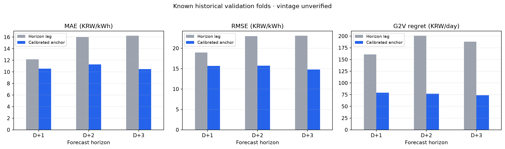
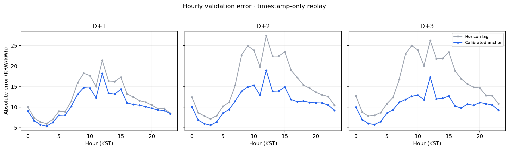

# SMP 예측 성능 개선 연구 결과

작성일: 2026-10-27 · 브랜치: `research/smp-performance-20261027`

## 결론

V5–V20의 기존 실험과 저장 산출물을 보존한 채, 23시 입력 컷오프를 지키는 시간순 재현 실험을 추가했다. 새로운 학습형 ML 모델은 학습하지 않았다. 새 shadow 후보는 최근 90개 완료일에서만 가중치를 보정하는 **horizon lag + 과거 동일 요일 SMP 앵커 혼합**이다.

재현 입력의 SMP 시각은 각 발급 origin 이하로 제한했지만, 원본 데이터의 `first_seen`은 대부분 2026-10-15에 기록되어 과거 origin 당시 수신 여부를 복원할 수 없다. 과거 구간은 모두 기존 연구에서 확인된 적이 있으므로, 이 결과는 **vintage 미검증 반복 백테스트**이며 독립 최종 시험이나 검증된 운영 성능으로 주장하지 않는다. V20 공식 발급 gate와 기존 운영 모델은 변경하지 않았다.

## 기존 모델 계보

| 버전 | 구조·기존 평가 | 이번 해석 |
|---|---|---|
| V5 | D+1 24시간 직접 HGB 잔차 예측, 일별 프로파일과 0.69/0.31 혼합. 2023년 10–12월 92일 저장 테스트 | 같은 기간 V5 모델 MAE 11.094, RMSE 13.809, G2V regret 24.02; V5 프로파일 기준선 13.576, 17.951, 128.73. 다른 시기 V20 결과와 직접 비교하지 않음 |
| V11 | 가격 전용 lag/calendar 잔차 모델; HGB, ExtraTrees, LightGBM, CatBoost 등. 별도 D+1/D+2 학습 | 2026Q3 저장 테스트에서 profile은 MAE가 낮고 ExtraTrees/HGB는 RMSE·regret이 낮아 단일 우승 모델 없음 |
| V12 | D+2 가격 모델군 및 급등/ramp 분류, 앙상블·위험 보정 실험 | validation ensemble, LightGBM peak 등 기존 후보 유지. `selection_predictions`의 2025Q4는 모델 선택에 사용된 구간이므로 독립 성능으로 취급하지 않음 |
| V14 | 가격 lag/shape와 수요·날씨·공급/정비 특징 연구; recency, relative shape, HGB/LGB 및 앙상블 | 여러 출력의 당시 가용성과 vintage가 입증되지 않음. 본 실험 표에는 저장된 공통기간 비교만 참고로 포함 |
| V15 | 9개 과거 이벤트 특징을 더한 LightGBM, 상대 이벤트 가중·2단계 급등 예측·analog | 2024Q4, 2025Q2, 2025Q4 사전 정의 folds에서 event LGB의 평균 가격오차는 기준선보다 낮았지만 fold별 G2V regret은 불안정. 기존 자격 기준을 모두 충족하지 못해 승격되지 않았음 |
| V17 | D+2/D+3 공동 HGB 잔차 가격예측 + 충전-window classifier/ranker | 가격 모델을 두 horizon에 공동 적용. 2026 42일 재현에서 D+2는 baseline보다 오차가 컸고 regret은 낮음; D+3은 지표별 결과가 엇갈림 |
| V19 | D+3 전용 HGB; V17 D+3 대비 분리 학습 검토 | 2025Q4 기존 평가에서 D+3 가격 MAE/RMSE가 V17보다 높고 G2V regret은 낮았음. 기존 승격되지 않음 |

## 실험 설계

각 2024Q4, 2025Q2, 2025Q4 fold에서 직전 90개 완료일을 보정 구간으로, 다음 분기를 시간순 검증 구간으로 사용했다. 각 예측은 24시간 전체 SMP를 맞추며, G2V regret은 60kWh EV, SOC 30→80%, 7kW, 효율 0.9, 열화비용 5, 24시간 연결 조건으로 계산했다. 기준선은 대상시각에서 horizon만큼 뒤의 같은 시간대 SMP다.

새 후보는 같은 시간대 horizon lag와 2/4/8주 과거 동일 요일 중앙값 또는 4주 평균 앵커를 혼합한다. 직전 보정구간의 MAE와 regret이 모두 horizon lag 기준선보다 나쁘지 않은 조합만 선택하고, MAE가 최소인 조합을 사용한다. 입력 timestamp는 23시 origin 이후를 배제한다. **첫 수신시각은 과거 구간에서 입증되지 않는다.**

## 시간순 validation 결과

세 fold의 hourly pooled RMSE와 날짜별 G2V regret 평균이다. 모든 숫자는 vintage 미검증 과거 재현이다.

| Horizon | 모델 | MAE | RMSE | G2V regret | 기준선 대비 |
|---|---|---:|---:|---:|---|
| D+1 | Horizon lag 기준선 | 12.149 | 18.934 | 160.92 | — |
| D+1 | 보정 anchor shadow | **10.533** | **15.649** | **79.21** | 세 지표 평균 개선 |
| D+2 | Horizon lag 기준선 | 16.017 | 22.986 | 200.62 | — |
| D+2 | 보정 anchor shadow | **11.301** | **15.747** | **77.08** | 세 지표 평균 개선 |
| D+3 | Horizon lag 기준선 | 16.219 | 23.052 | 188.07 | — |
| D+3 | 보정 anchor shadow | **10.467** | **14.794** | **73.89** | 세 지표 평균 개선 |

각 fold에서 보정 후보가 persistence를 앞섰지만, 이 fold들은 모두 프로젝트에서 이미 검토된 기간이다. 특히 계절 앵커 가중치는 기간에 따라 달라졌고 이는 distribution shift 가능성을 보여준다.

## 동일 42일 V20 재현 재비교

기존 V20 42일 대상일을 유지하고 origin 직전 90일로 매 대상일마다 보정했다. RMSE는 기존 V20 점수표와 맞춰 일별 RMSE의 42일 평균으로 표시했다.

| Horizon | 모델 | MAE | RMSE | G2V regret | 비교 |
|---|---|---:|---:|---:|---|
| D+1 | 기존 horizon lag 기준선 | 8.159 | 11.872 | 135.71 | 기존 42일 |
| D+1 | rolling anchor shadow | 8.596 | **11.464** | **98.44** | MAE 0.44 악화, RMSE/regret 개선 |
| D+2 | 기존 horizon lag 기준선 | **9.734** | 13.809 | 100.01 | 기존 42일 |
| D+2 | V17_joint 저장 재현 | 11.355 | 14.421 | 89.17 | 기존 42일 |
| D+2 | rolling anchor shadow | 10.699 | **13.656** | **74.46** | V17 대비 세 지표 개선; lag 기준선보다 MAE는 높음 |
| D+3 | 기존 horizon lag 기준선 | 11.079 | 15.237 | 80.01 | 기존 42일 |
| D+3 | V17_joint 저장 재현 | 11.292 | 14.387 | **75.39** | 기존 42일 |
| D+3 | rolling anchor shadow | **11.172** | **14.141** | 79.00 | V17 대비 가격 오차 개선, regret 3.62 악화 |

이 비교는 같은 실제값·대상일을 썼지만, 과거 입력 첫 수신시각과 V17 모델 파일의 당시 가용성은 입증되지 않았다. 따라서 D+2의 수치는 promising shadow 진단이며 검증된 운영 성능 향상이라고 할 수 없다.

## 후보 탈락 및 일반화 진단

- **2/4/8주 단일 anchor:** 2주 중앙값은 전체 fold 평균 가격오차가 가장 낮은 단순 seasonal 후보였지만, horizon별로 다중목표를 함께 만족하지 않는 기간이 있었다.
- **고정 4주 median 보정 blend:** 세 fold 모두 기준선을 개선했지만, 2025Q4 D+2 공통일에서는 MAE 12.925, RMSE 17.866, regret 121.69로 V15 event LGB(12.827, 17.210, 112.69)보다 나빴다.
- **변동성 적응 가중:** 최신 일간 profile과 계절 기준의 차이가 클 때 계절 가중을 줄였으나, 고정 보정 blend보다 세 horizon 평균 지표가 나빠 탈락시켰다.
- **D+1 2026Q3 audit 재확인:** 2026Q2 보정 후 후보는 Q3에서 MAE 14.580/RMSE 21.863/regret 63.97이었다. 같은 날짜 V11 fixed profile은 10.215/18.248/55.88, V11 ExtraTrees는 10.406/16.209/34.97이었다. 계절 blend를 D+1 운영 후보에서 제외한다.
- **V15 급등 모델:** 3-fold 전체 평균 event LGB는 기준선 MAE 10.731→10.185, RMSE 14.628→14.180으로 개선했지만 평균 regret은 75.11→74.85에 그쳤고, 2025Q4 단일 fold에서는 regret이 88.58→112.69로 악화했다. 한 fold 개선으로 승격하지 않는다.

## 현재 horizon별 선정

- **D+1:** 새 계절 후보는 탈락. V5는 자체 92일 테스트에서 그 시기의 모델 우위가 있었지만 현재 시기와 다른 평가기간이다. 현재 사용 중인 V20 D+1 baseline 및 V11 후보를 유지한다.
- **D+2:** rolling anchor를 별도 shadow 후보로 선정한다. 같은 V20 42일 재현에서 V17보다 가격오차와 regret이 모두 낮았으나, 2025Q4 기존 V12/V15와의 비교에서는 앞서지 못했고 vintage 한계도 남아 있다. V20 운영 V17을 교체하지 않는다.
- **D+3:** 새 후보는 V17보다 가격오차가 조금 낮고 regret이 높다. V19 전용 D3 HGB도 과거 Q4 가격 지표를 개선하지 못했다. 다중목표에서 우위를 보인 모델이 없어 V17을 유지한다.

## 산출물·적용

- 재현 가능한 실험: `experiments/smp_performance/run_study.py`
- 기존 V20 동일 42일 비교: `experiments/smp_performance/evaluate_v20_replay.py`
- shadow 알고리즘 설정: `docs/smp_improvement/final_candidate.json`
- V20 입력 snapshot에 연결할 adapter: `v20/research_model_adapter.py`
- fold별 표: `docs/smp_improvement/walk_forward_metrics.csv`
- hourly 예측·오차: `docs/smp_improvement/walk_forward_predictions.csv`, `docs/smp_improvement/hourly_errors.csv`
- 42일 공통일 요약·상세: `docs/smp_improvement/v20_42day_rolling_shadow_summary.csv`, `v20_42day_rolling_shadow_daily.csv`, `v20_42day_rolling_shadow_hourly.csv`
- 대표 SMP 비교: `v20_42day_d1_comparison.png`, `v20_42day_d2_comparison.png`, `v20_42day_d3_comparison.png`
- 시간순 validation 종합표: `walk_forward_summary.csv`
- 기존 버전 저장 성능 대조표: `legacy_model_comparison.csv`
- V20 연결 안내: `V20_SHADOW_INTEGRATION.md`

Adapter는 입력 snapshot에 `first_seen`이 있으면 각 23시 origin까지 수신된 행만 사용하고, horizon lag 및 anchor 시각이 origin 이하인지 확인한다. 따라서 보존된 옛 시점으로 실행하면 자료가 부족하다고 실패하거나 baseline으로 떨어질 수 있다. 운영 발급 gate에 연결하거나 V20 모델을 교체하는 코드는 이번 브랜치에 넣지 않았다.

## 남은 검증과 판단

과거 2023–2026 SMP의 원본 최초 수신·수정 vintage와 V5–V19 모델별 과거 checkpoint 잠금시각이 확보되지 않아, 사전예측 검증된 일반화 개선을 선언할 수 없다. 이번 분석으로 D+2 shadow 재현 후보는 확보했지만, 운영 교체 전에는 앞으로 생성되는 immutable 23시 snapshot과 독립적인 target 실적을 비교해야 한다. 현재 최선의 결정은 **V20 운영 모델 유지, D+2 후보 shadow 검증, D+1/D+3 새 후보 미승격**이다.
