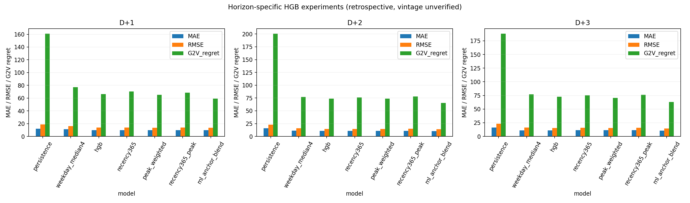
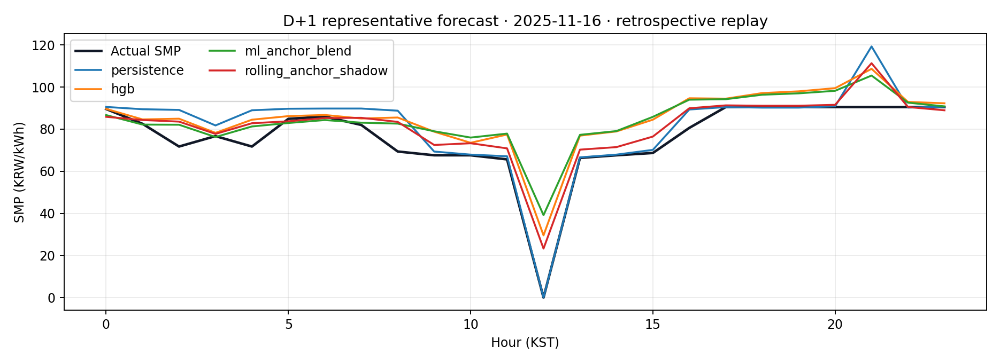
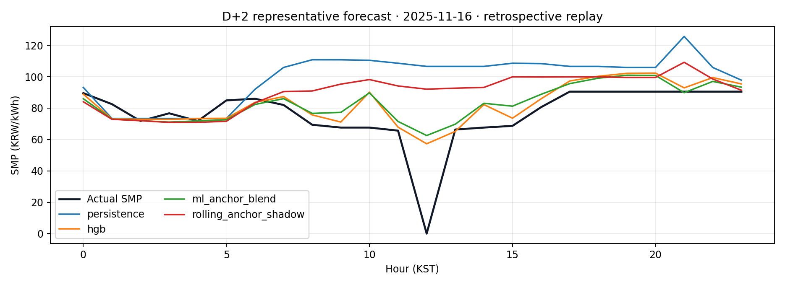
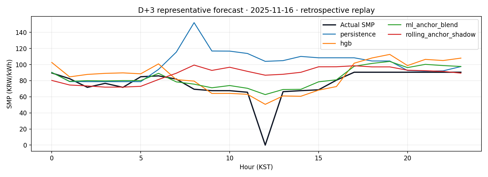

# D+1~D+3 학습형 후보 개선 실험

작성일: 2026-10-27 KST
기준 브랜치: `research/smp-performance-20261027` / 시작 커밋 `4ffae45`

## 요약

기존 V5~V20 및 원본 평가 산출물을 보존하고, 각 예측 기간에 별도의 직접 HGB 잔차 모델을 학습했다. 기존 V11/V17 가격 입력과 동일한 21개 SMP 시계열·달력 특징을 쓰며, D+1은 V11 builder, D+2/D+3은 V17 builder로 입력을 생성한다. LightGBM 재학습은 현재 Python 환경에 `lightgbm` 패키지가 없어 실행할 수 없었다. 새 모델은 연구용 shadow artifact로만 저장했고 V20 서비스나 공식 발급 gate에는 연결하지 않았다.

세 개 시간순 fold에서 학습 → 직전 분기 calibration → 다음 분기 validation을 수행했다. fold는 2024Q4, 2025Q2, 2025Q4이며 합계 275개 target day/horizon이다. 데이터 timestamp는 23:00 KST issue origin 이하의 과거 lag만 사용했다. SMP 원본의 과거 `first_seen` vintage는 확인되지 않으므로, 결과는 과거 정보 가용성을 증명하는 운영 재현이나 독립 최종 테스트가 아니다. 모든 validation 기간은 기존 프로젝트에서 한 번 이상 검토된 구간이다.

EV 평가는 모든 후보에 60kWh, SOC 30→80%, 7kW, 효율 0.9, full target-day 연결 조건을 고정했다. G2V regret은 해당 후보 예측으로 선택한 충전 schedule의 실제 SMP 비용과 실제 SMP oracle schedule의 비용 차이다. 급등 시간은 actual SMP ≥150 KRW/kWh로 정의했다.

## 공통 기간 전체 결과

RMSE는 동일한 24시간 hourly 표본 전체를 합쳐 산출했다. MAE와 G2V regret은 target day별 값의 평균이다. 괄호는 horizon-lag persistence 기준선 대비 개선율이다.

| Horizon | 후보 | MAE | RMSE | G2V regret (KRW/day) | 기준선 대비 MAE / RMSE / regret |
|---|---|---:|---:|---:|---:|
| D+1 | Horizon-lag persistence | 12.149 | 18.934 | 160.92 | 기준 |
|  | Peak-weighted HGB | **9.625** | 13.681 | 65.31 | 20.8% / 27.7% / 59.4% 개선 |
|  | Calibration-selected HGB/anchor blend | 9.626 | **13.528** | **59.18** | 20.8% / 28.6% / 63.2% 개선 |
| D+2 | Horizon-lag persistence | 16.017 | 22.986 | 200.62 | 기준 |
|  | HGB / anchor blend | **10.175** | **14.223** | **65.41** | 36.5% / 38.1% / 67.4% 개선 |
| D+3 | Horizon-lag persistence | 16.219 | 23.052 | 188.07 | 기준 |
|  | HGB / anchor blend | **10.429** | **14.621** | **63.18** | 35.7% / 36.6% / 66.4% 개선 |

각 fold에서 HGB variant와 anchor 혼합 weight는 앞선 calibration 분기만 이용해 정했다. 고정 계절 중앙값만 사용하는 후보는 HGB 혼합보다 약했고, 365일 recency weight는 기본 HGB를 일관되게 개선하지 못했다. 급등 sample weight는 D+1 가격 MAE가 사실상 같고 급등 MAE를 낮추는 데 도움이 됐지만 D+2/D+3에서는 가격 MAE 최선이 아니었다. D+2/D+3의 혼합 후보는 MAE와 EV regret을 함께 개선했으나 급등 시간 오차는 일부 단독 weighted HGB보다 컸다.

## 기존 모델과 공통 날짜 대조

| Horizon / 기간 | 모델 | MAE | RMSE | G2V regret | 해석 |
|---|---|---:|---:|---:|---|
| D+1 2026Q3, 92일 | V11 ExtraTrees | 10.406 | 14.105 | **34.97** | 보존 예측. 세 점수 기준 새 refit보다 우세 |
|  | V11 HGB | 10.721 | 14.127 | 41.49 | 보존 예측 |
|  | 새 peak-weighted HGB | 10.770 | 14.293 | 45.72 | 같은 Q3 진단, 승자 선택에 사용 안 함 |
| D+2 2025Q4, 92일 | V12 LightGBM peak | 13.297 | 17.837 | 84.31 | 저장 시간별 예측 재채점 |
|  | V14 shape-level blend | 13.415 | 17.564 | **70.79** | 저장 시간별 예측 재채점 |
|  | V15 event-feature LightGBM | 12.827 | 17.210 | 112.69 | 가격 오차와 regret tradeoff |
|  | 새 HGB / anchor blend | **12.143** | **15.223** | 79.47 | V12/V15보다 세 지표 개선, V14보다 regret 높음 |
| D+3 2025Q4, 92일 | V17 joint D3 | 15.328 | 18.322 | 107.36 | 기존 daily 결과 |
|  | V19 independent HGB | 15.620 | 18.316 | 94.96 | 기존 daily 결과 |
|  | 새 HGB / anchor blend | **12.995** | **15.880** | **80.28** | 기존 V17/V19보다 세 지표 모두 낮음 |

이 기간들은 모델 선택·진단에 이미 이용된 과거 구간이므로, 위 차이는 추가적인 재현 증거이지 독립적인 성능 개선 확증이 아니다. V17의 D+2 보존 파일에는 full24 일별 MAE와 EV regret은 있지만 hourly forecast가 없어 RMSE는 계산하지 않았다. 현재 `lightgbm`이 없어 V12/V14/V15/V17 joblib 모델도 직접 재실행하지 않았고, 기존 저장 시간별 출력으로 비교 가능한 항목만 채점했다. 기존 scikit-learn joblib 일부는 저장 당시 1.9.0, 현재 1.7.0에서 로드되어 호환성 경고가 발생했다. 그 모델의 새 예측값은 사용하지 않았다.

V5의 과거 92일 결과는 별도 평가기간·입력 schema여서 위 D+1 공통 검증표에 섞지 않았다. V5 및 V11의 저장 결과는 원본 위치에서 보존했다.

## 최종 shadow 추천

| Horizon | Validation에서 가장 유망한 방법 | 최근 90일 calibration으로 생성한 shadow bundle | 판단 |
|---|---|---|---|
| D+1 | Peak-weighted HGB와 HGB/anchor blend의 MAE 차이가 0.001 미만 | Peak-weighted HGB, seasonal anchor weight 0.00 | V11 ExtraTrees가 2026Q3 paired audit에서 더 좋아 운영 교체 비추천 |
| D+2 | Horizon-specific HGB + 4주 same-hour median anchor 혼합 | Peak-weighted HGB, seasonal weight 0.05 | Q4/V17보다 유망하나 V14 regret 및 vintage 한계가 있어 shadow 유지 |
| D+3 | Horizon-specific HGB + calibration-selected anchor blend | HGB, seasonal weight 0.05 | 같은 Q4에서 V17/V19보다 우세; 독립 운영 검증 전 shadow 유지 |

Bundle은 2026-10-26까지 이용 가능한 target label만으로 refit했다. 원본 데이터에 이후 날짜가 있음을 발견해 cutoff를 명시적으로 적용했다. 최근 90일 calibration은 2026-07-29~2026-10-26이다. 이 시기의 학습 label이 실제 23시 당시 입수 가능했던 vintage인지 여부는 입증되지 않는다.

## 예측 그래프

아래 그래프는 2025Q4 validation 가운데 대표일 2025-11-16의 실제값과 사전 origin feature로 재현한 후보를 보여준다. 해당일 12시 actual 값 0은 원본 SMP DB에 수록됐지만 과거 공개 시각 및 해당 단일 0의 의미를 입증할 수 없어 그래프를 해석할 때 주의해야 한다. V20의 별도 zero-response audit는 일부 전체 0 응답의 공개 의미를 미확인으로 남겼다.

시간대별 오차 및 급등 시간 MAE/RMSE는 `hourly_error_by_model_hour.csv`, `peak_error_summary.csv`에 있다.

## V20 연결 방법과 승격 조건

비운영 adapter `v20/ml_shadow_adapter.py`는 저장된 연구 bundle을 읽어 24시간 예측을 반환한다. 호출 측이 `timestamp`, `smp`, 가능한 경우 `first_seen`을 포함한 as-of SMP snapshot과 target date, horizon을 전달하면 된다. adapter는 nominal 23:00 이후 SMP 또는 receipt를 제거하고 D+1/D+2/D+3 feature builder를 선택한다. `first_seen` vintage가 있으면 issue time 이후 수신 row를 제외한다.

웹 화면에서는 이 결과를 운영 예측과 별도의 **연구 shadow** 탭/선으로 표시하고, 모델명·학습 종료일·as-of origin을 보여주는 방식으로 연결할 수 있다. 이번 커밋은 V20 서비스 코드에 adapter를 연결하지 않았고 자동 발급 gate나 운영 모델을 바꾸지 않았다. 모델 joblib은 현재 Python scikit-learn 1.7.0 환경과 일치하는 trusted local artifact다.

운영 승격 전에는 원본 SMP의 immutable 23시 입력 snapshot과 공식 실적을 새 독립 날짜에서 축적해야 한다. 기준선 대비 D+1~D+3 MAE/RMSE, 급등 시간 오차, 동일 EV 조건 G2V regret을 사전 등록한 기간 동안 재평가해야 한다.

## 산출물

- 재현 학습·비교: `experiments/smp_performance/train_ml_candidates.py`
- 기존 산출물만 재사용한 오차표 및 그래프 생성: `experiments/smp_performance/render_ml_results.py`
- 공통 fold 점수: `summary.csv`, `daily_scores.csv`, `hourly_predictions.csv`
- 기존 후보 paired score: `d1_v11_2026q3_common_date_diagnostic.csv`, `d2_2025q4_common_date_comparison.csv`, `d3_v17_v19_common_date_comparison.csv`
- 저장 모델 호환성 감사: `legacy_model_load_audit.csv`
- horizon별 shadow bundle: `d1_recommended_shadow.joblib`, `d2_recommended_shadow.joblib`, `d3_recommended_shadow.joblib`
- V20 비운영 adapter: `v20/ml_shadow_adapter.py`
- 연구 cutoff, fold 및 EV 조건: `study_manifest.json`
